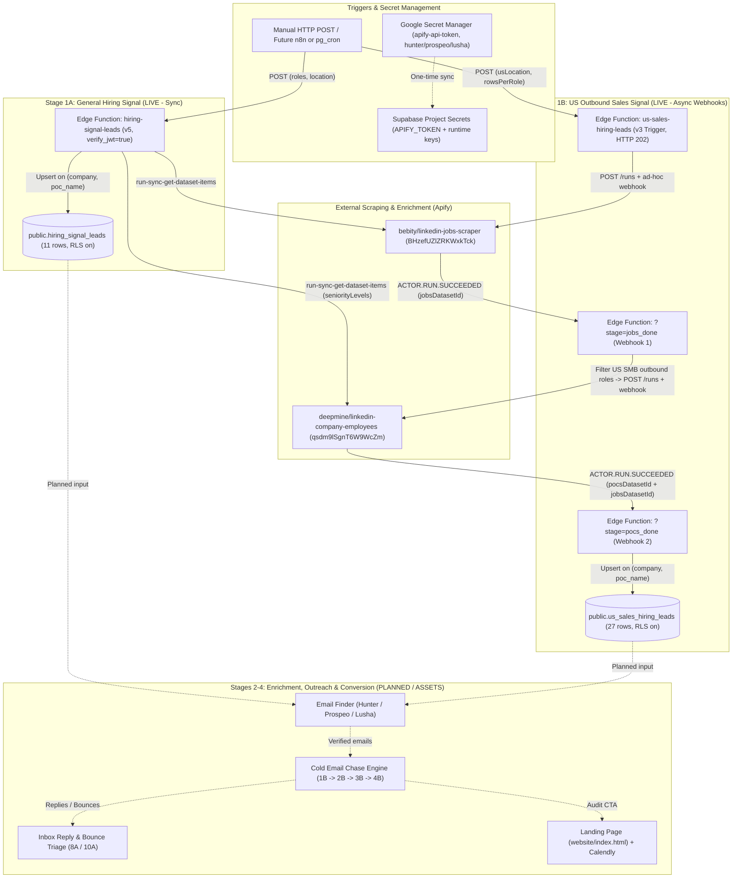
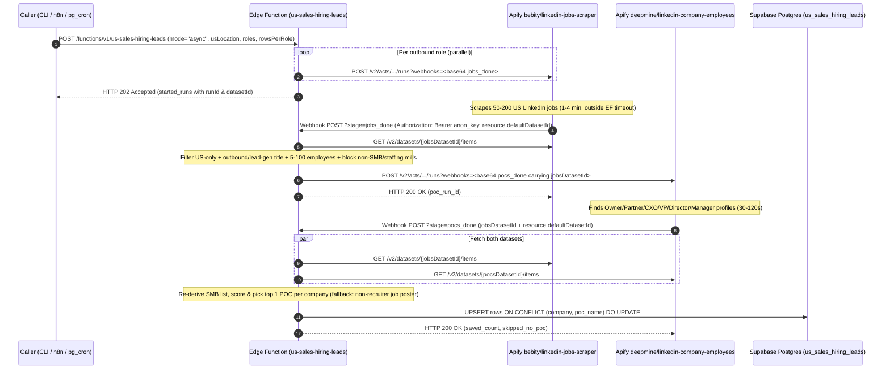
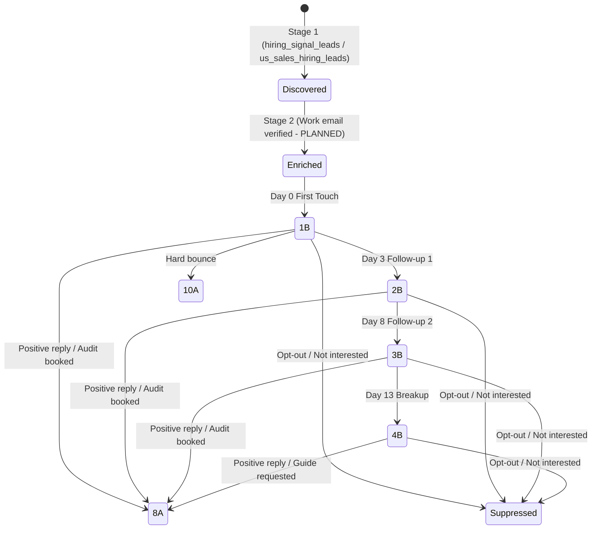

# Client Finder — End-to-End System Architecture

> **Last updated:** 2026-11-19
> **Central Database / Core Platform:** Supabase (`uwsncuowtzydylfabikj`) — `public.hiring_signal_leads` & `public.us_sales_hiring_leads`
> **Scope:** Automated B2B lead-discovery and cold-outreach system for Julienne Mae Anito's AI & Business Automation consultancy, connecting Apify scraping actors, Supabase Edge Functions, PostgreSQL lead tables, static conversion assets, and planned downstream enrichment/outreach stages.

---

## 1. Executive Summary

This system identifies small-to-medium businesses (SMBs) showing the **#1 high-intent automation buying signal** — actively hiring for manual admin, operations, or outbound sales/lead-gen roles — resolves a single high-authority decision-maker (`poc_name`, `poc_role`) at each company, and persists deduplicated leads into Supabase for downstream cold-email outreach.

The pipeline is split into decoupled stages to respect serverless execution limits (Supabase Edge Function's 150s HTTP gateway timeout), minimize Apify per-result spend, and maintain an **upsert-only** data contract:

1. **Stage 1A — General SMB Hiring Signal (`hiring-signal-leads`, LIVE — Sync):** Scrapes LinkedIn Jobs (default: Australia, admin/ops/sales roles) via Apify, filters to SMBs, enriches decision-makers via Apify `deepmine`, and upserts into `public.hiring_signal_leads`.
2. **Stage 1B — US Outbound Sales Hiring Signal (`us-sales-hiring-leads`, LIVE — Async Webhook Chaining):** Triggers large-scale US outbound/lead-gen job scrapes asynchronously (`trigger` -> `jobs_done` -> `pocs_done`), filters strictly to verified US SMBs hiring outbound/lead-gen roles, resolves executive/sales decision-makers via Apify `deepmine`, and upserts into `public.us_sales_hiring_leads`.
3. **Stage 2 — Work Email Enrichment (PLANNED):** Resolves verified business emails from `(poc_name, company_domain)` using Hunter.io / Prospeo / Lusha (keys already stored in Google Secret Manager; sibling implementations exist in `hunter_io_email_finder` / `poc_enrichment`).
4. **Stage 3 — Cold Email & Chase Engine (PLANNED):** Plain-text 4-touch sequence (`Day 0 -> Day 3 -> Day 8 -> Day 13`, states `1B -> 2B -> 3B -> 4B`) sent from an owned domain/inbox, referencing the anonymized case study (`02_case_study_anonymized.md`) and directing prospects to the landing page (`website/index.html`) / Calendly audit booking link.
5. **Stage 4 — Reply & Bounce Triage (PLANNED):** Classifies inbox responses into `8A` (interested/booked), `guide` (lead magnet requested), opt-out suppression, or `10A` (bounced/closed).

---

## 2. High-Level System Architecture

---

## 3. Execution Sequence / Async Lifecycle (`us-sales-hiring-leads`)

The `us-sales-hiring-leads` Edge Function avoids Supabase's 150-second HTTP gateway timeout by chaining two stateless Apify ad-hoc webhooks without needing any intermediate staging tables:

---

## 4. Stage-by-Stage Component Breakdown

### Stage 1A: General SMB Hiring-Signal Discovery (`hiring-signal-leads`)
- **System / Runtime:** Supabase Edge Function (Deno 2, `npm:@supabase/supabase-js@2`)
- **Endpoint / Source Path:**
  - Live URL: `https://uwsncuowtzydylfabikj.supabase.co/functions/v1/hiring-signal-leads` (`ACTIVE`, v5, `verify_jwt: true`)
  - Source: `supabase/functions/hiring-signal-leads/index.ts`
  - Migration: `supabase/migrations/20261119_create_hiring_signal_leads.sql`
- **Trigger / Live Schedule:** Manual HTTP `POST` (`GET` returns health status + `has_apify_token` flag). No `pg_cron` schedule attached yet.
- **Queue / Input Filter:**
  - Defaults: `roles = ["Admin Assistant", "Operations Coordinator", "Sales Admin", "SDR"]`, `location = "Australia"`, `rowsPerRole = 15`, `publishedAt = "r604800"` (last 7 days), `minEmployees = 5`, `maxEmployees = 50`, `includeUnknownSize = true`, `maxCompanies = 25`.
  - Excludes public-sector/institution names (`university`, `tafe`, `government`, `department of`, `city council`, `shire council`, `hospital`, `ministry of`, `public school`).
- **Processing Logic:**
  1. Validates `APIFY_TOKEN` (fallback `APIFY_API_TOKEN`), `SUPABASE_URL`, and `SUPABASE_SERVICE_ROLE_KEY`.
  2. Executes `bebity~linkedin-jobs-scraper` synchronously (`run-sync-get-dataset-items`, `timeout=80s`) in parallel across requested `roles`.
  3. Computes employee count as `Math.max(companySize, companyEmployeeCount)` to prevent enterprises with partial counts from bypassing the SMB cap.
  4. Extracts normalized `company_domain` from `companyWebsite` (falling back to non-ATS `applyUrl`), deduplicating by domain or normalized company name.
  5. Calls `deepmine~linkedin-company-employees` synchronously (`timeout=110s`, `maxResults: 5`, `seniorityLevels: ["Owner", "Partner", "CXO", "VP", "Director", "Manager"]`, `enrichProfiles: false`).
  6. Scores each employee via `scorePocRole()` (`Founder/Owner: 100` -> `MD/CEO/Principal: 90` -> `COO/GM: 80` -> `Ops/Office Manager: 70` -> `Director/VP: 55`) and keeps the top single POC per company, falling back to `posterFullName` if not an external recruiter.
- **Outputs & Handoff Signal:** Upserts into `public.hiring_signal_leads` via `onConflict: "company,poc_name"`. Rows with non-null `company_domain` + `poc_name` are ready for Stage 2 email enrichment.

### Stage 1B: US Outbound Sales Hiring-Signal Discovery (`us-sales-hiring-leads`)
- **System / Runtime:** Supabase Edge Function (Deno 2, `npm:@supabase/supabase-js@2`)
- **Endpoint / Source Path:**
  - Live URL: `https://uwsncuowtzydylfabikj.supabase.co/functions/v1/us-sales-hiring-leads` (`ACTIVE`, v3, `verify_jwt: true`)
  - Source: `supabase/functions/us-sales-hiring-leads/index.ts`
  - Migration: `supabase/migrations/20261119_create_us_sales_hiring_leads.sql`
- **Trigger / Live Schedule:** Manual HTTP `POST` (default `mode: "async"`, optional `mode: "sync"`; `GET` returns health status). Self-invoked via Apify ad-hoc webhooks at `?stage=jobs_done` and `?stage=pocs_done`. No `pg_cron` schedule attached yet.
- **Queue / Input Filter:**
  - Enforces US-only location (`usLocation` auto-appends `, United States` if country omitted; rejects listings matching non-US country names via `isNonUsLocation()`).
  - Defaults: `roles = ["Sales Development Representative", "Business Development Representative", "Lead Generation Specialist", "Outbound Sales Representative"]`, `rowsPerRole = 100` (async) / `20` (sync), `publishedAt = "r604800"`, `minEmployees = 5`, `maxEmployees = 100`, `includeUnknownSize = false`, `maxCompanies = 30`.
  - **Outbound/Lead-Gen Title Guard (`isOutboundOrLeadGenJobTitle`):** Requires `sdr`, `bdr`, `sales development`, `business development representative/specialist/associate/coordinator`, `lead gen`, `outbound`, `cold call`, `appointment setter`, `prospecting`, `inside sales`, or `demand gen`; explicitly excludes `retail`, `store`, `cashier`, `door-to-door`, `field sales`, `dealership`, `canvasser`, and `customer service`.
  - **Organization Guard (`isNonTargetOrganization`):** Blocks universities (substring match, catching `CQUniversity`), colleges, schools, hospitals, government, and 19 major US staffing mills (`Robert Half`, `Randstad`, `Adecco`, `TEKsystems`, `Insight Global`, `Jobot`, etc.).
- **Processing Logic:**
  1. **Trigger (`POST` without `stage`):** Launches one async `bebity~linkedin-jobs-scraper` run per role with a Base64-encoded ad-hoc `ACTOR.RUN.SUCCEEDED` webhook targeting `?stage=jobs_done` (authenticated via `headersTemplate` carrying `SUPABASE_ANON_KEY`). Returns HTTP `202` immediately.
  2. **Webhook 1 (`?stage=jobs_done`):** Downloads `jobsDatasetId`, runs `extractDiscoveredCompanies()`, and launches async `deepmine~linkedin-company-employees` (`maxResults: 5`, `seniorityLevels: ["Owner", "Partner", "CXO", "VP", "Director", "Manager"]`, no `location` restriction so remote founders match) with a second webhook targeting `?stage=pocs_done` carrying only `jobsDatasetId` + `config`.
  3. **Webhook 2 (`?stage=pocs_done`):** Fetches both `jobsDatasetId` and `pocsDatasetId` in parallel, scores sales/exec POCs via `scoreSalesDecisionMaker()` (`Founder/Owner: 100` -> `CEO/President/MD: 95` -> `CRO/VP Sales/Head of Sales: 90` -> `COO/GM: 80` -> `RevOps/Sales Manager: 70`), selects 1 POC per company, and upserts into `public.us_sales_hiring_leads`.
- **Outputs & Handoff Signal:** Upserts into `public.us_sales_hiring_leads` (`onConflict: "company,poc_name"`).

### Stage 2–4: Planned Downstream Pipeline & Packaging Assets (Not Yet Wired to Live Tables)
- **Packaging & Conversion Assets (Repo):**
  - `01_offer_and_positioning.md` — 3-tier offer ladder (Free 15-min mini-audit -> Paid Tier 1 Audit -> Tier 2 Fixed-Scope Builds -> Tier 3 Monthly Retainer).
  - `02_case_study_anonymized.md` — Anonymized travel & adventure company case study (30+ workflows, ~40 hrs/week saved) + pre-publish anonymization checklist.
  - `03_cold_email_sequence.md` — Plain-text 4-touch chase sequence (`Day 0 / 3 / 8 / 13`, states `1B -> 2B -> 3B -> 4B`, reply triage `8A` / `10A` / `guide`).
  - `website/index.html` — Single-file portfolio/conversion page (`Julienne Mae Anito · AI & Business Automation Consultant`) with live Calendly link (`https://calendly.com/juliennemaeanito-de/30min`); `window.SITE.email`, `location`, and `abn` remain blank until business domain is purchased.
- **Planned Code Reuse (External Sibling Repos, Not Inspected):** Per `CLAUDE.md` and `as_built.txt`, enrichment (`hunter_io_email_finder`, `poc_enrichment`, `Alternate Lead Finder`), chase engine (`education_sector_automations`), and Gmail label triage (`educ_leads_gmail_label_watchers`) live in sibling folders outside this workspace and have not yet been connected to `hiring_signal_leads` or `us_sales_hiring_leads`.

---

## 5. Central Data Contract (Database Schema & State Machine)

### Table 1: `public.hiring_signal_leads`
- **Unique Key:** `hiring_signal_leads_company_poc_unique UNIQUE (company, poc_name)`
- **Indexes:** `idx_hiring_signal_leads_company (company)`, `idx_hiring_signal_leads_created_at (created_at DESC)`
- **Trigger:** `trg_hiring_signal_leads_updated_at` (`BEFORE UPDATE` -> `set_hiring_signal_leads_updated_at()`)
- **RLS:** Enabled (`true`), zero public/anon policies (accessible via `service_role` only).

| Column | Type | Nullable / Default | Written By | Read By | Purpose |
| --- | --- | --- | --- | --- | --- |
| `id` | `uuid` | `NO` / `gen_random_uuid()` | Postgres | Downstream enrichment | Primary key |
| `company` | `text` | `NO` / — | `hiring-signal-leads` | Enrichment / Outreach | Hiring company name (part of upsert key) |
| `poc_name` | `text` | `NO` / — | `hiring-signal-leads` | Enrichment / Outreach | Selected decision-maker full name (part of upsert key) |
| `poc_role` | `text` | `NO` / — | `hiring-signal-leads` | Outreach personalization | Decision-maker job title / cleaned headline |
| `company_domain` | `text` | `YES` / `NULL` | `hiring-signal-leads` | Stage 2 email finder | Normalized domain (ATS/job-board domains stripped) |
| `hiring_role` | `text` | `YES` / `NULL` | `hiring-signal-leads` | `{{icebreaker}}` copy | Exact job title company is currently hiring for |
| `job_url` | `text` | `YES` / `NULL` | `hiring-signal-leads` | Audit / QA | Source LinkedIn job posting URL |
| `source` | `text` | `NO` / `'apify_linkedin_jobs'` | `hiring-signal-leads` | Attribution | Actor lineage (`apify:<job>+<poc>` or `:poster`) |
| `created_at` | `timestamptz` | `NO` / `now()` | Postgres | Reporting | Initial discovery timestamp |
| `updated_at` | `timestamptz` | `NO` / `now()` | Trigger on upsert | Dedupe tracking | Last upsert timestamp |

### Table 2: `public.us_sales_hiring_leads`
- **Unique Key:** `us_sales_hiring_leads_company_poc_unique UNIQUE (company, poc_name)`
- **Indexes:** `idx_us_sales_hiring_leads_company (company)`, `idx_us_sales_hiring_leads_created_at (created_at DESC)`
- **Trigger:** `trg_us_sales_hiring_leads_updated_at` (`BEFORE UPDATE` -> `set_us_sales_hiring_leads_updated_at()`)
- **RLS:** Enabled (`true`), zero public/anon policies (`service_role` only).

| Column | Type | Nullable / Default | Written By | Read By | Purpose |
| --- | --- | --- | --- | --- | --- |
| `id` | `uuid` | `NO` / `gen_random_uuid()` | Postgres | Downstream enrichment | Primary key |
| `company` | `text` | `NO` / — | `us-sales-hiring-leads` | Enrichment / Outreach | US hiring company name (part of upsert key) |
| `poc_name` | `text` | `NO` / — | `us-sales-hiring-leads` | Enrichment / Outreach | Top sales/exec decision-maker name (part of upsert key) |
| `poc_role` | `text` | `NO` / — | `us-sales-hiring-leads` | Outreach personalization | Decision-maker title / cleaned headline |
| `company_domain` | `text` | `YES` / `NULL` | `us-sales-hiring-leads` | Stage 2 email finder | Normalized corporate domain |
| `hiring_role` | `text` | `YES` / `NULL` | `us-sales-hiring-leads` | `{{icebreaker}}` copy | Outbound/lead-gen role being hired |
| `job_location` | `text` | `YES` / `NULL` | `us-sales-hiring-leads` | Regional segmentation | US city/state from the job listing |
| `job_url` | `text` | `YES` / `NULL` | `us-sales-hiring-leads` | Audit / QA | Source LinkedIn job posting URL |
| `source` | `text` | `NO` / `'apify_us_sales_jobs'` | `us-sales-hiring-leads` | Attribution | Actor lineage (`apify:<job>+<poc>` or `:poster`) |
| `created_at` | `timestamptz` | `NO` / `now()` | Postgres | Reporting | Initial discovery timestamp |
| `updated_at` | `timestamptz` | `NO` / `now()` | Trigger on upsert | Dedupe tracking | Last upsert timestamp |

### Live Snapshot Volume (Queried `2026-11-19`)

| Table | Total Rows | Rows With `company_domain` | Notes |
| --- | ---: | ---: | --- |
| `public.hiring_signal_leads` | **11** | 7 (64%) | AU test + real batch; includes 4 pre-tightening non-SMB rows |
| `public.us_sales_hiring_leads` | **27** | 26 (96%) | US nationwide + 4-state (TX/FL/CA/NY) async runs; includes 1 v1 enterprise row (`Cisco`) |

### Planned Lead Lifecycle State Machine (Per `03_cold_email_sequence.md`)

---

## 6. External Data Mappings

### Apify Actor Input/Output Mapping

| Apify Actor | Actor ID | Key Input Params | Output Fields Mapped to DB |
| --- | --- | --- | --- |
| `bebity/linkedin-jobs-scraper` | `BHzefUZlZRKWxkTck` | `title`, `location`, `rows`, `publishedAt` | `companyName` -> `company`; `companyWebsite` / non-ATS `applyUrl` -> `company_domain`; `title` -> `hiring_role`; `location` -> `job_location`; `jobUrl` -> `job_url`; `companySize` & `companyEmployeeCount` -> SMB size filter; `posterFullName`/`posterHeadline` -> fallback POC |
| `deepmine/linkedin-company-employees` | `qsdm9lSgnT6W9WcZm` | `companies`, `maxResults: 5`, `seniorityLevels`, `enrichProfiles: false`, `maxResultsTotal`, `proxyConfiguration` | `fullName` -> `poc_name`; `jobTitle` / cleaned `headline` -> `poc_role`; `searchQuery` / `currentCompany` -> join key back to `company` |

### Ad-Hoc Webhook Payload Contracts (`us-sales-hiring-leads`)
- **Stage 1 (`?stage=jobs_done`):** `{ searchedRole, config: FilterConfig, resource: { id, defaultDatasetId, ... } }`
- **Stage 2 (`?stage=pocs_done`):** `{ jobsDatasetId, searchedRole, config: FilterConfig, resource: { id, defaultDatasetId, ... } }`

---

## 7. Systems, Identifiers & Configuration Inventory

### External Resources & Endpoints

| System | Identifier / Endpoint | Role |
| --- | --- | --- |
| Supabase Project | `uwsncuowtzydylfabikj` (`https://uwsncuowtzydylfabikj.supabase.co`) | Shared Postgres DB + Edge Function host (also hosts n8n tables & unrelated `pg_cron` jobs) |
| Edge Function (AU/General) | `https://uwsncuowtzydylfabikj.supabase.co/functions/v1/hiring-signal-leads` | Live v5 sync discovery + POC enrichment |
| Edge Function (US Outbound) | `https://uwsncuowtzydylfabikj.supabase.co/functions/v1/us-sales-hiring-leads` | Live v3 async webhook discovery + POC enrichment |
| Apify Job Actor | `bebity~linkedin-jobs-scraper` (`BHzefUZlZRKWxkTck`) | LinkedIn job postings + company size/website extraction (~$0.00125/job) |
| Apify POC Actor | `deepmine~linkedin-company-employees` (`qsdm9lSgnT6W9WcZm`) | LinkedIn decision-maker lookup (unmatched seniority levels not billed) |
| Calendly | `https://calendly.com/juliennemaeanito-de/30min` | Audit booking link embedded in `website/index.html` |
| Static Landing Page | `website/index.html` | Local single-file conversion page (not yet hosted on custom domain) |

### Active Schedules / Cron Table

| Job Name | Schedule (UTC) | Local Time (UTC+8) | Target | Status |
| --- | --- | --- | --- | --- |
| *(None for Client Finder yet)* | — | — | `hiring-signal-leads` / `us-sales-hiring-leads` | Manual HTTP `POST` trigger only |
| *(33 existing `pg_cron` jobs on `uwsncuowtzydylfabikj`)* | Various (`22:00–23:00 UTC` Sun–Thu, etc.) | `06:00–07:00 UTC+8` Mon–Fri | Unrelated n8n / MAG / LinkedIn / education workflows | Active (outside Client Finder scope — do not alter) |

### Secrets & Environment Variables Matrix (Names Only)

| Component | Required Secret / Env Var Names | Storage Location |
| --- | --- | --- |
| `hiring-signal-leads` & `us-sales-hiring-leads` | `APIFY_TOKEN` (fallback `APIFY_API_TOKEN`) | Supabase Edge Function Secrets (`uwsncuowtzydylfabikj`), synced from GSM `apify-api-token` |
| `hiring-signal-leads` & `us-sales-hiring-leads` | `SUPABASE_URL`, `SUPABASE_ANON_KEY`, `SUPABASE_SERVICE_ROLE_KEY` | Auto-injected by Supabase Edge Runtime |
| Deployment / DB Admin | `SUPABASE_ACCESS_TOKEN` | Local file outside repo (`Downloads`) & GSM (`SUPABASE_ACCESS_TOKEN` / `supabase-access-token`) |
| Planned Stage 2 Enrichment | `hunter-io-api-key`, `prospeo-api-key`, `lusha_api_key` | Google Secret Manager (not yet synced to `uwsncuowtzydylfabikj` secrets) |
| Planned Stage 3 Sending | Own domain mailbox credentials + DNS (`SPF`/`DKIM`/`DMARC`) | Not yet provisioned (must NOT use MAG mailbox) |

---

## 8. Key Operational Gotchas & Maintenance Notes

1. **Shared Database With Production n8n (`uwsncuowtzydylfabikj`):** The Supabase project hosts ~93 n8n internal tables and 33 active `pg_cron` jobs belonging to other automations. Never run destructive migrations, schema resets, or bulk deletes; all Client Finder writes are strictly isolated to `public.hiring_signal_leads` and `public.us_sales_hiring_leads` with upsert-only semantics.
2. **Apify Monthly Spend Cap (`$19.00/mo`):** As of `2026-11-19`, account usage is `$15.75 / $19.00` (`$3.25` remaining this billing cycle). A 4-state US async run (600 jobs + POC enrichment) costs ~$0.90 USD (`bebity` accounts for ~84% of spend; `deepmine` ~16% thanks to `seniorityLevels` pre-filtering). Avoid triggering more than 3–4 full state batches before the monthly cap resets or is raised.
3. **Sync vs. Async Timeout Behavior:**
   - `us-sales-hiring-leads` (v3) defaults to `mode: "async"` via Apify ad-hoc webhooks and handles `80–200` rows per role with zero timeouts.
   - `hiring-signal-leads` (v5) is **still synchronous-only** — keep `rowsPerRole <= 20` and `maxCompanies <= 20` per request to stay below Supabase's 150s HTTP gateway timeout (`504`), or port it to the same async webhook pattern.
4. **Live vs. Repo Documentation Drift:** `CLAUDE.md` and `as_built.txt` (dated `2026-11-17`) still describe the workspace as docs-only with no pipeline built. In reality, Stage 1 discovery (2 live Edge Functions + 2 live tables) and `website/index.html` are now built.
5. **Pre-Fix Legacy Rows in Live Tables:**
   - `public.hiring_signal_leads` still defaults `includeUnknownSize: true` and uses `\buniversity\b` (which misses `CQUniversity` / `College`), so 4 non-SMB rows from early runs remain in the table.
   - `public.us_sales_hiring_leads` contains 1 legacy enterprise row (`Cisco`) from v1 before the `Math.max(companySize, companyEmployeeCount)` fix (v2/v3 now block it cleanly).
   - A couple of scraped `company_domain` values point to redirect/social links (e.g. `hubs.li`, `youtube.com`) and should be filtered or resolved before Stage 2 email lookup.
6. **Alternative Apify Actor Permission Gate:** `code_crafter~leads-finder` (`IoSHqwTR9YGhzccez`) requires manual full-permission approval in the Apify Console (`HTTP 403` otherwise). Both Edge Functions default to `deepmine~linkedin-company-employees` (`qsdm9lSgnT6W9WcZm`), which is already approved on the account.
7. **Website & Compliance Prerequisites Before Cold Sending:** Before connecting Stage 3 cold email, populate `window.SITE.email` and `location` in `website/index.html`, deploy on an owned business domain with warmed SPF/DKIM/DMARC records, include a physical address + opt-out footer (Australian Spam Act / CAN-SPAM), and confirm employment/IP boundaries before targeting Australian tourism operators.
