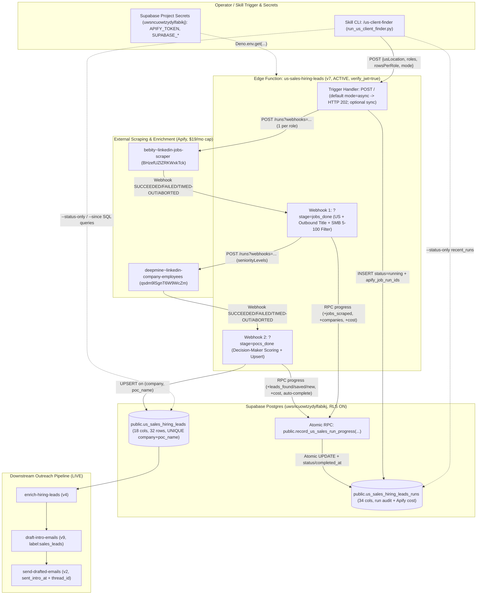
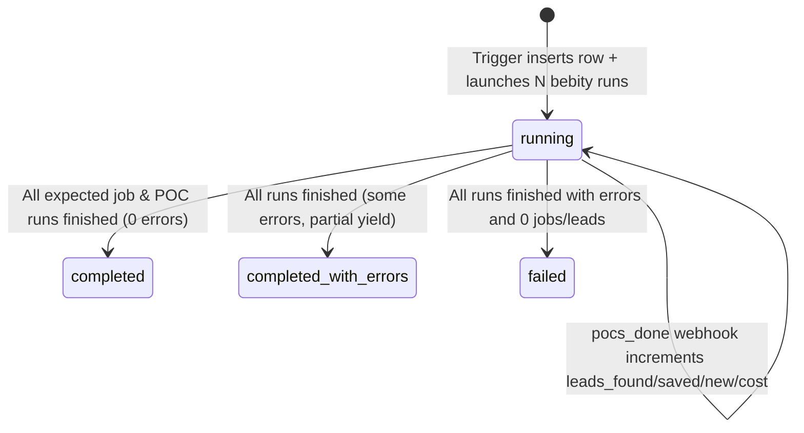

# US Outbound Sales Hiring Signal Pipeline (`us-sales-hiring-leads`) — System Architecture

> **Last updated:** 2026-11-23
> **Central Database / Core Platform:** Supabase (`uwsncuowtzydylfabikj`) — `public.us_sales_hiring_leads` (18 cols) & `public.us_sales_hiring_leads_runs` (34 cols) + Apify (`bebity~linkedin-jobs-scraper` & `deepmine~linkedin-company-employees`)
> **Scope:** Asynchronous webhook-chained serverless discovery pipeline that scrapes US LinkedIn outbound/SDR/BDR/lead-gen job postings by state, filters strictly to verified US SMBs (5–100 employees), resolves the highest-authority executive or sales decision-maker per company, upserts deduplicated leads into `public.us_sales_hiring_leads`, and logs full funnel metrics and Apify spend atomically into `public.us_sales_hiring_leads_runs`.

---

## 1. Executive Summary

Finding US small-to-medium businesses (5–100 employees) that are actively hiring outbound sales, SDR, BDR, or lead-generation staff is a high-intent automation signal — proving both operational outbound pain and approved payroll budget. Running multi-role LinkedIn job scrapes and company employee enrichment synchronously inside a single HTTP call hits Supabase Edge Function's 150-second HTTP gateway timeout (`504`) whenever job boards return enterprise-heavy listings.

`us-sales-hiring-leads` solves this through a **zero-staging-table, two-stage Apify webhook chain** paired with an **atomic PostgreSQL run-logging RPC**:

1. **Stage 1 — Trigger & Run Log Creation (`POST /us-sales-hiring-leads`, HTTP 202):** Validates the requested US state (`usLocation`), role list, and SMB filters, inserts a `status = 'running'` row into `public.us_sales_hiring_leads_runs` (returning `run_log_id`), launches one asynchronous `bebity~linkedin-jobs-scraper` Apify run per role with Base64-encoded ad-hoc webhooks pointing back to `?stage=jobs_done`, records `apify_job_run_ids`, and returns HTTP `202` in ~2–3 seconds.
2. **Stage 2 — Job Filtering & POC Fan-Out (`?stage=jobs_done`):** Receives each `bebity` Apify webhook (`SUCCEEDED`, `FAILED`, `TIMED-OUT`, or `ABORTED`), downloads the jobs dataset, applies strict US-only, outbound-role, non-target-organization, and SMB headcount (`5..100`) filters, launches an async `deepmine~linkedin-company-employees` run with a second webhook pointing to `?stage=pocs_done` (carrying only `runLogId`, `jobsDatasetId`, `searchedRole`, and `config`), and atomically increments `jobs_scraped`, `companies_discovered`, `expected_poc_runs`, `apify_poc_run_ids`, and `apify_cost_usd`.
3. **Stage 3 — Decision-Maker Scoring, Upsert & Auto-Finalization (`?stage=pocs_done`):** Downloads both the jobs and POC datasets in parallel, scores candidate executives/sales leaders via `scoreSalesDecisionMaker()` (with a non-recruiter job-poster fallback), upserts deduplicated `(company, poc_name)` rows into `public.us_sales_hiring_leads`, and calls `public.record_us_sales_run_progress(...)` to atomically record `poc_items_fetched`, `leads_found`, `leads_saved`, `leads_new`, `skipped_no_poc`, and `apify_cost_usd` — automatically marking the run `completed` (or `completed_with_errors` / `failed`) once all expected job and POC webhooks finish.
4. **Stage 4 — Downstream Handoff:** Newly inserted rows enter `public.us_sales_hiring_leads` with `enrichment_id = NULL` and flow sequentially through `enrich-hiring-leads` (v4) → `draft-intro-emails` (v9) → `send-drafted-emails` (v2).

---

## 2. High-Level System Architecture



---

## 3. Execution Sequence / Lifecycle

```mermaid
sequenceDiagram
    autonumber
    participant Op as Operator / Skill ("run_us_client_finder.py")
    participant EF as Edge Function ("us-sales-hiring-leads" v7)
    participant DB as Supabase Postgres ("us_sales_hiring_leads" & "_runs")
    participant Bebity as Apify ("bebity~linkedin-jobs-scraper")
    participant Deepmine as Apify ("deepmine~linkedin-company-employees")

    Op->>EF: POST /functions/v1/us-sales-hiring-leads ({ usLocation: "Illinois", rowsPerRole: 75, mode: "async" })
    EF->>DB: INSERT INTO us_sales_hiring_leads_runs (state="Illinois", status="running", expected_job_runs=4)
    DB-->>EF: run_log_id (uuid)

    par Launch 1 Apify job run per role (default 4 roles)
        EF->>Bebity: POST /acts/bebity~linkedin-jobs-scraper/runs?webhooks=base64(?stage=jobs_done)
        Bebity-->>EF: { runId, defaultDatasetId }
    end

    EF->>DB: UPDATE us_sales_hiring_leads_runs SET apify_job_run_ids = [...]
    EF-->>Op: HTTP 202 ({ ok: true, run_log_id, state, started_runs[] })

    loop As each bebity run finishes (parallel webhooks)
        Bebity->>EF: POST ?stage=jobs_done ({ runLogId, searchedRole, config, resource })
        EF->>Bebity: GET /datasets/{jobsDatasetId}/items
        Bebity-->>EF: Raw LinkedIn job items
        Note over EF: Filter non-US, non-outbound titles, staffing mills/edu/gov, non-SMB (5-100)
        alt discovered.length > 0
            EF->>Deepmine: POST /acts/deepmine~linkedin-company-employees/runs?webhooks=base64(?stage=pocs_done)
            Deepmine-->>EF: { runId: pocRunId }
            EF->>DB: RPC record_us_sales_run_progress (+1 completed_job_runs, +1 expected_poc_runs, +jobs, +companies, +cost, pocRunId)
        else discovered.length == 0
            EF->>DB: RPC record_us_sales_run_progress (+1 completed_job_runs, +jobs, +cost)
        end
    end

    loop As each deepmine run finishes (parallel webhooks)
        Deepmine->>EF: POST ?stage=pocs_done ({ runLogId, jobsDatasetId, searchedRole, config, resource })
        EF->>Bebity: GET /datasets/{jobsDatasetId}/items
        EF->>Deepmine: GET /datasets/{pocsDatasetId}/items
        Note over EF: Score decision-makers (Founder/Owner -> CEO -> VP/Head Sales -> COO/GM; non-recruiter poster fallback)
        alt dryRun = false
            EF->>DB: UPSERT INTO us_sales_hiring_leads ON CONFLICT (company, poc_name)
            DB-->>EF: savedRows (newCount = rows where created_at == updated_at)
        end
        EF->>DB: RPC record_us_sales_run_progress (+1 completed_poc_runs, +leads_found/saved/new, +skipped_no_poc, +cost)
        Note over DB: Auto-marks status='completed', completed_at=now(), duration_seconds when all job & POC runs finish
    end
```

---

## 4. Stage-by-Stage Component Breakdown

### Stage 1: Trigger, Validation & Run Initialization (`POST /`)
- **System / Runtime:** Supabase Edge Function (Deno 2, `npm:@supabase/supabase-js@2`, native `fetch`)
- **Endpoint / Source Path:**
  - Live URL: `https://uwsncuowtzydylfabikj.supabase.co/functions/v1/us-sales-hiring-leads` (**v7, `ACTIVE`, `verify_jwt: true`**, Function ID `f562aded-9904-407a-b8fd-57add8dcd6e2`)
  - Source: `supabase/functions/us-sales-hiring-leads/index.ts`
  - Skill & CLI Runner: `.agents/skills/us-client-finder/SKILL.md` & `.agents/skills/us-client-finder/scripts/run_us_client_finder.py`
- **Trigger / Live Schedule:** Manual HTTP `POST` (typically via `/us-client-finder` CLI). `GET` returns health status, `runs_table`, and default actors/roles. No `pg_cron` schedule attached.
- **Input Processing:**
  1. Defaults `mode = "async"`, `roles = ["Sales Development Representative", "Business Development Representative", "Lead Generation Specialist", "Outbound Sales Representative"]`, `rowsPerRole = 100` (clamped `1..200`, sync default `20`), `publishedAt = "r604800"` (7 days), `minEmployees = 5`, `maxEmployees = 100`, `includeUnknownSize = false`, `maxCompanies = 30` (clamped `1..60`).
  2. Derives clean `state` label (e.g., `"Illinois"` from `"Illinois"` or `"Illinois, United States"`) and normalized `location` query (`"Illinois, United States"`).
  3. Inserts a `status = 'running'` log row into `public.us_sales_hiring_leads_runs` and starts 1 `bebity~linkedin-jobs-scraper` run per role (or executes synchronously when `mode = "sync"`).

### Stage 2: Job Filtering & POC Fan-Out (`?stage=jobs_done`)
- **Webhook Events Subscribed:** `ACTOR.RUN.SUCCEEDED`, `ACTOR.RUN.FAILED`, `ACTOR.RUN.TIMED_OUT`, `ACTOR.RUN.ABORTED` (authenticated via `headersTemplate` carrying `SUPABASE_ANON_KEY`).
- **Filtering Pipeline (`extractDiscoveredCompanies`):**
  1. **Non-Target Org Exclusion (`isNonTargetOrganization`):** Rejects universities, colleges, schools, hospitals, health systems, government entities, and 19 major staffing/recruiting mills (Robert Half, Randstad, Adecco, TEKsystems, Insight Global, Jobot, etc.).
  2. **Outbound Role Filter (`isOutboundOrLeadGenJobTitle`):** Keeps SDR, BDR, outbound, lead gen, appointment setter, prospecting, inside sales, and demand gen titles; explicitly rejects retail, showroom, dealership, door-to-door/D2D, canvasser, and customer service listings.
  3. **US Location Guard (`isNonUsLocation`):** Rejects non-US country listings.
  4. **Strict SMB Headcount Guard:** Computes `Math.max(sizeBracketCount, rawEmployeeCount)` so enterprises with partial employee counts cannot bypass the `minEmployees..maxEmployees` (`5..100`) window; drops unknown-size listings unless `includeUnknownSize: true`.
  5. **Domain Normalization (`extractDomain`):** Strips `www.` and ignores 28 job-board/ATS domains (`linkedin.com`, `greenhouse.io`, `lever.co`, `workday.com`, `ashbyhq.com`, etc.), then deduplicates companies by `domain ?? normalizedCompany` up to `maxCompanies`.
- **Stage 2 Launch & Progress Recording:** Starts `deepmine~linkedin-company-employees` with `seniorityLevels: ["Owner", "Partner", "CXO", "VP", "Director", "Manager"]`, `enrichProfiles: false`, `maxResults: 5`, `maxResultsTotal: min(discovered.length * 5, 150)`, and calls `record_us_sales_run_progress` with `usageTotalUsd` from `resource`.

### Stage 3: Decision-Maker Resolution, Upsert & Atomic Run Finalization (`?stage=pocs_done`)
- **Decision-Maker Scoring (`scoreSalesDecisionMaker`):**
  - `100`: Founder / Co-Founder / Owner / Proprietor
  - `95`: CEO / President / Managing Director / Principal / Partner
  - `90`: CRO / VP Sales / Head of Sales / Director of Sales / VP Business Development / Head of Growth
  - `80`: COO / General Manager / Head or VP of Operations
  - `70`: Sales Ops / RevOps / Sales Manager / Operations Manager / BD Manager
  - `55` / `40` / `20`: Generic Director/VP/Head → Manager/Lead → other
- **Poster Fallback:** If `deepmine` returns no match for a company, falls back to the LinkedIn job poster (`posterName`, `posterRole`) ONLY when `!looksLikeExternalRecruiter(posterRole)`.
- **Upsert & New-Lead Detection:** Upserts into `public.us_sales_hiring_leads` on `onConflict: "company,poc_name"` and counts brand-new inserts (`created_at === updated_at`).
- **Atomic Run Closure (`record_us_sales_run_progress`):** Single `UPDATE` inside PostgreSQL (`SECURITY DEFINER`, `service_role`-only) prevents race conditions across concurrent webhooks and transitions `status` to `'completed'` (or `'completed_with_errors'` / `'failed'`) with `completed_at` and `duration_seconds` as soon as `completed_job_runs >= expected_job_runs AND completed_poc_runs >= expected_poc_runs`.

---

## 5. Central Data Contract (Database Schema & State Machine)

### Migrations Applied
- `supabase/migrations/20261119_create_us_sales_hiring_leads.sql`: Core lead table, `UNIQUE (company, poc_name)`, `updated_at` trigger, RLS ON.
- `supabase/migrations/20261121_add_draft_columns_to_hiring_leads.sql`: Added `drafted_at`, `gmail_draft_id`, and draft queue index.
- `supabase/migrations/20261123_add_thread_id_to_hiring_leads.sql`: Added `thread_id` + partial index.
- `supabase/migrations/20261123_create_us_sales_hiring_leads_runs.sql`: Created `public.us_sales_hiring_leads_runs` (34 cols, RLS ON, 3 indexes, `updated_at` trigger) and atomic RPC `public.record_us_sales_run_progress(...)`.

### Table 1: `public.us_sales_hiring_leads` (18 Columns, RLS ON)

| Column | Type | Nullable / Default | Written By | Read By | Purpose |
| --- | --- | --- | --- | --- | --- |
| `id` | `uuid` | `NO` / `gen_random_uuid()` (PK) | Postgres | All downstream functions | Row identifier |
| `company` | `text` | `NO` / — | `us-sales-hiring-leads` | Enrichment / Drafting / Sending | Company name (part 1 of `UNIQUE (company, poc_name)`) |
| `poc_name` | `text` | `NO` / — | `us-sales-hiring-leads` | Enrichment / Drafting / Sending | Decision-maker full name (part 2 of unique key) |
| `poc_role` | `text` | `NO` / — | `us-sales-hiring-leads` | `draft-intro-emails` | Decision-maker title |
| `company_domain` | `text` | `YES` / `NULL` | `us-sales-hiring-leads` | Enrichment / `draft-intro-emails` | Cleaned corporate domain (ATS/job boards stripped) |
| `hiring_role` | `text` | `YES` / `NULL` | `us-sales-hiring-leads` | `draft-intro-emails` | Matched LinkedIn job title |
| `job_location` | `text` | `YES` / `NULL` | `us-sales-hiring-leads` | `draft-intro-emails` / Skill `--status-only` | US city/state location |
| `job_url` | `text` | `YES` / `NULL` | `us-sales-hiring-leads` | `draft-intro-emails` | LinkedIn job URL for live posting hydration |
| `source` | `text` | `NO` / `'apify_us_sales_jobs'` | `us-sales-hiring-leads` | Audit | Provenance (`apify:<job>+<poc>` or `apify:<job>:poster`) |
| `created_at` | `timestamptz` | `NO` / `now()` | Postgres | Run log (`leads_new` check) | Initial discovery timestamp |
| `updated_at` | `timestamptz` | `NO` / `now()` | `BEFORE UPDATE` trigger | Skill `--since` | Last modification timestamp |
| `email`, `enrichment_id`, `enriched_at` | `text`, `int`, `timestamptz` | `YES` / `NULL` | `enrich-hiring-leads` | `draft-intro-emails` | Work email enrichment state (`1` = found, `2` = not found) |
| `drafted_at`, `gmail_draft_id` | `timestamptz`, `text` | `YES` / `NULL` | `draft-intro-emails` | `draft-intro-emails`, `send-drafted-emails` | Gmail draft tracking |
| `sent_intro_at`, `thread_id` | `timestamptz`, `text` | `YES` / `NULL` | `send-drafted-emails` | `draft-intro-emails` / reply tracking | Outbound send timestamp & Gmail thread ID |

### Table 2: `public.us_sales_hiring_leads_runs` (34 Columns, RLS ON)

| Column Group | Columns | Types / Defaults | Written By | Purpose |
| --- | --- | --- | --- | --- |
| Identity & Scope | `id`, `state`, `location_query`, `mode`, `dry_run`, `status` | `uuid` PK, `text`, `boolean`, `text` (`'running'`) | `us-sales-hiring-leads` + RPC | Requested US state, LinkedIn location query, execution mode, lifecycle state |
| Search Config | `roles`, `rows_per_role`, `published_at`, `min_employees`, `max_employees`, `max_companies` | `text[]`, `integer`, `text` | `us-sales-hiring-leads` (insert) | Reproducible query & SMB filter configuration |
| Async Progress | `expected_job_runs`, `completed_job_runs`, `expected_poc_runs`, `completed_poc_runs` | `integer` (`0`) | Insert + `record_us_sales_run_progress` | Tracks concurrent webhook completion barrier |
| Funnel Metrics | `jobs_scraped`, `companies_discovered`, `poc_items_fetched`, `leads_found`, `leads_saved`, `leads_new`, `skipped_no_poc` | `integer` (`0`) | `record_us_sales_run_progress` | End-to-end discovery & yield counts |
| Cost & Audit | `apify_cost_usd`, `job_actor_id`, `leads_actor_id`, `apify_job_run_ids`, `apify_poc_run_ids`, `error_messages` | `numeric(10,5)` (`0`), `text`, `text[]` (`'{}'`) | Insert + `setRunJobIds` + RPC | Exact Apify spend per run, actor IDs, Apify run IDs, failure traces |
| Timestamps | `started_at`, `completed_at`, `duration_seconds`, `created_at`, `updated_at` | `timestamptz`, `integer` | Insert + RPC + `BEFORE UPDATE` trigger | Runtime duration & chronological run history |

### Run Lifecycle State Machine



### Live Snapshot Volume (Queried `2026-11-23`)

| Table | Total Rows | Notes |
| --- | ---: | --- |
| `public.us_sales_hiring_leads` | **32** | `31` with `company_domain`; covered states: NY (`12`), FL (`6`), IL (`5`), TX (`5`), CA (`3`), MO (`1`); `6` sent (`6/6` with `thread_id`) |
| `public.us_sales_hiring_leads_runs` | **0** | Newly created (`2026-11-23`); ready to log all future runs automatically |

---

## 6. External Data Mappings

### Request Contract (`POST /functions/v1/us-sales-hiring-leads`)

| Request Field | Type / Default | Behavior |
| --- | --- | --- |
| `mode` | `"async" \| "sync"` / `"async"` | Async returns HTTP `202` and chains webhooks; sync runs inline for tiny smoke tests |
| `usLocation` | `string` / `"United States"` | Auto-appends `, United States` if omitted; cleaned `state` logged in `us_sales_hiring_leads_runs.state` |
| `roles` | `string[]` / 4 outbound roles | Launches 1 `bebity` run per role |
| `rowsPerRole` | `number` / `100` async (`20` sync) | Clamped `1..200` LinkedIn job listings per role |
| `publishedAt` | `string` / `"r604800"` | LinkedIn recency filter (`r86400` = 24h, `r604800` = 7d) |
| `minEmployees` / `maxEmployees` | `number` / `5`..`100` | Strict SMB headcount bounds |
| `includeUnknownSize` | `boolean` / `false` | Drops listings with unknown employee count by default |
| `maxCompanies` | `number` / `30` | Clamped `1..60` SMB companies enriched per role |
| `dryRun` | `boolean` / `false` | Skips `us_sales_hiring_leads` upserts (still logs the run with `dry_run = true`) |

---

## 7. Systems, Identifiers & Configuration Inventory

### External Resources & Endpoints

| System | Identifier / Endpoint | Role |
| --- | --- | --- |
| Supabase Project | `uwsncuowtzydylfabikj` (`https://uwsncuowtzydylfabikj.supabase.co`) | Postgres DB + Edge Function host |
| Discovery Edge Function | `https://uwsncuowtzydylfabikj.supabase.co/functions/v1/us-sales-hiring-leads` | Live **v7** (`ACTIVE`, `verify_jwt: true`, ID `f562aded-9904-407a-b8fd-57add8dcd6e2`) |
| Apify Stage 1 Actor | `bebity~linkedin-jobs-scraper` (`BHzefUZlZRKWxkTck`) | LinkedIn Jobs scraping (~$0.00125/job, ~84% of spend) |
| Apify Stage 2 Actor | `deepmine~linkedin-company-employees` (`qsdm9lSgnT6W9WcZm`) | Company executive/sales POC lookup (~16% of spend) |
| Local Skill & CLI | `.agents/skills/us-client-finder/scripts/run_us_client_finder.py` | Operator CLI (`--status-only`, `--location`, `--since`, `--wait-seconds`) |

### Active Schedules / Cron Table

| Job Name | Cron (UTC) | Local Time (UTC+8) | Target | Status |
| --- | --- | --- | --- | --- |
| *(None for `us-sales-hiring-leads`)* | — | — | `us-sales-hiring-leads` | Manual HTTP `POST` / `/us-client-finder` trigger only |
| *(35 unrelated `pg_cron` jobs on `uwsncuowtzydylfabikj`)* | Various | Various | Unrelated n8n workflows (`33` active, `2` inactive) | Untouched |

### Secrets & Environment Variables Matrix (Names Only)

| Component | Required Var / Secret Names | Storage Location |
| --- | --- | --- |
| `us-sales-hiring-leads` (Supabase DB & Webhooks) | `SUPABASE_URL`, `SUPABASE_ANON_KEY`, `SUPABASE_SERVICE_ROLE_KEY` | Auto-injected by Supabase Edge Runtime (`uwsncuowtzydylfabikj`) |
| `us-sales-hiring-leads` (Apify) | `APIFY_TOKEN` (fallback `APIFY_API_TOKEN`) | Supabase Edge Function Secrets (`uwsncuowtzydylfabikj`), synced from GCP Secret Manager (`apify-api-token`) |
| CLI Helper (`run_us_client_finder.py`) | `SUPABASE_ACCESS_TOKEN` (or `SUPABASE_ANON_KEY`) | Environment or local `~/Downloads/SUPABASE_ACCESS_TOKEN.txt` |

---

## 8. Key Operational Gotchas & Maintenance Notes

1. **Apify Monthly Spend Cap (`$19.00/mo`):** 1 US state × 4 default roles × `rowsPerRole=75` (300 jobs) costs roughly **$0.35–$0.45 USD**. Avoid launching more than 2–3 states at once; check `public.us_sales_hiring_leads_runs` via `--status-only` first to see which states were already scraped and their exact `apify_cost_usd` yield.
2. **`sync` Mode Cost Limitation:** In `mode = "async"`, Apify webhooks deliver exact `resource.usageTotalUsd` for both `bebity` and `deepmine`, which is summed accurately into `apify_cost_usd`. In `mode = "sync"`, Apify's `/run-sync-get-dataset-items` endpoint returns only dataset items (no run metadata), so `apify_cost_usd` remains `0` on sync runs.
3. **Deduplication Across Parallel Roles in Async Mode:** In `async` mode, each role runs in its own `bebity` → `deepmine` chain. If the same company hires for both SDR and BDR in the same state, both callbacks may discover it (`companies_discovered` / `leads_found` reflect sum across role chains), while `us_sales_hiring_leads` remains deduplicated via `UNIQUE (company, poc_name)` and `leads_new` counts only brand-new inserts (`created_at === updated_at`).
4. **Stale `running` Rows If Webhook Delivery Fails:** Subscribing to `FAILED`, `TIMED-OUT`, and `ABORTED` handles actor failures cleanly, but if an Edge Function webhook itself returns HTTP 5xx and Apify exhausts retries, a run row could remain `status = 'running'`. Inspect `expected_job_runs` vs `completed_job_runs` and `expected_poc_runs` vs `completed_poc_runs` to diagnose any stuck run.
5. **Skill Doc Version Reference:** `.agents/skills/us-client-finder/SKILL.md` still refers to the function as `v3`; live production is now **v7** with full `us_sales_hiring_leads_runs` logging.
6. **Live Function Inventory (7 Active Functions on `uwsncuowtzydylfabikj`):** `hiring-signal-leads` (v9), `us-sales-hiring-leads` (v7), `enrich-hiring-leads` (v4), `draft-intro-emails` (v9), `enrich-autodoc-employees` (v3), `draft-intro-emails-dk` (v5), and `send-drafted-emails` (v2).
