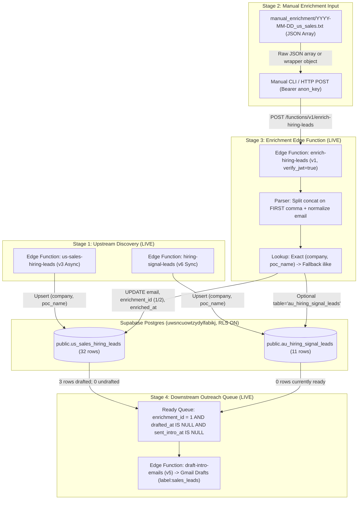
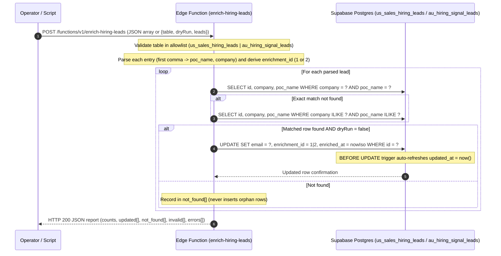
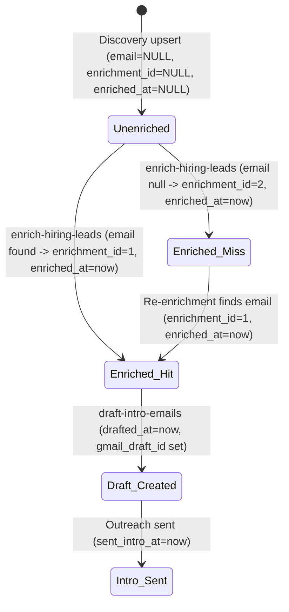

# Lead Enrichment Pipeline — System Architecture

> **Last updated:** 2026-11-21
> **Central Database / Core Platform:** Supabase (`uwsncuowtzydylfabikj`) — `public.us_sales_hiring_leads` & `public.au_hiring_signal_leads`
> **Scope:** End-to-end manual and serverless enrichment pipeline ingesting researched POC email batches from `manual_enrichment/*.txt` through the `enrich-hiring-leads` Supabase Edge Function into PostgreSQL lead tables to unlock Stage 3 intro outreach.

---

## 1. Executive Summary

Stage 1 hiring-signal discovery (`us-sales-hiring-leads` and `hiring-signal-leads`) captures high-intent SMBs (`company`, `poc_name`, `poc_role`, `company_domain`, `hiring_role`, `job_url`) without a verified work email address. This Lead Enrichment subsystem bridges discovery to cold outreach by cleanly recording enrichment outcomes (both hits and misses) against existing lead rows without creating duplicates or touching unrelated tables in the shared Supabase database.

1. **Stage 1 — Unenriched Lead Discovery (Upstream):** `us-sales-hiring-leads` (US outbound SMBs) and `hiring-signal-leads` (AU general SMBs) upsert discovered companies and top decision-makers into `public.us_sales_hiring_leads` and `public.au_hiring_signal_leads` with `email = NULL`, `enrichment_id = NULL`, and `enriched_at = NULL`.
2. **Stage 2 — Manual Email Research Batch (`manual_enrichment/*.txt`):** Human/assistant research produces a dated JSON array (`[{ "concat": "POC Name, Company Name", "email": "..." | null }]`) for newly discovered leads.
3. **Stage 3 — Serverless Enrichment Updator (`enrich-hiring-leads` Edge Function):** Validates the target table against an explicit allowlist, splits `concat` safely on the **first comma only**, matches existing rows by `(company, poc_name)` (exact match + case-insensitive fallback), updates `email`, sets `enrichment_id` (`1` = email found, `2` = no email found), and stamps `enriched_at = now()`.
4. **Stage 4 — Outreach Handoff (Downstream):** Rows with `enrichment_id = 1` and `sent_intro_at IS NULL` form the exact queue ready for tailored intro email drafting/sending (using `tailored_email_intros/` and the Personal Gmail OAuth pipeline).

---

## 2. High-Level System Architecture



---

## 3. Execution Sequence / Lifecycle



---

## 4. Stage-by-Stage Component Breakdown

### Stage 1: Manual Enrichment Batch Files
- **System / Runtime:** Local workspace text/JSON files
- **Source Paths:**
  - `manual_enrichment/2026-11-21_us_sales.txt` (structured JSON array format used by `enrich-hiring-leads`)
  - `manual_enrichment/manual_enrichment.txt` (legacy plain-text pairs from 2026-11-19)
  - `prompts/261121_enrichment_edge_function.txt` (specification prompt)
- **Format Contract:**
  ```json
  [
    { "concat": "Amy Larko Falanga, The Larko Group", "email": "alarko@thelarkogroup.com" },
    { "concat": "Robert Demaree, Verde Trader", "email": null }
  ]
  ```

### Stage 2: Lead Enrichment Edge Function (`enrich-hiring-leads`)
- **System / Runtime:** Supabase Edge Function (Deno 2, `npm:@supabase/supabase-js@2`)
- **Endpoint / Source Path:**
  - Live URL: `https://uwsncuowtzydylfabikj.supabase.co/functions/v1/enrich-hiring-leads` (**v1, `ACTIVE`, `verify_jwt: true`**)
  - Source: `supabase/functions/enrich-hiring-leads/index.ts`
- **Trigger / Live Schedule:** Manual HTTP `POST` (`GET` returns health status & allowed tables). No `pg_cron` schedule attached.
- **Input / Allowlist Filter:**
  - Accepts either a raw JSON array (`[{ concat, email }]`) or a wrapper object (`{ table?, dryRun?, leads | items | records }`).
  - Also accepts explicit `{ poc_name, company, email }` objects in place of `concat`.
  - `table` defaults to `us_sales_hiring_leads` and is strictly allowlisted to `us_sales_hiring_leads` or `au_hiring_signal_leads`.
- **Processing Logic:**
  1. Validates `SUPABASE_URL` and `SUPABASE_SERVICE_ROLE_KEY` from Edge Runtime env (service role bypasses RLS).
  2. Parses each item: splits `concat` on the **first comma only** (`concat.indexOf(",")`) so company names containing commas (e.g., `Integrity Insurance and Financial Services IL, TX`) remain intact.
  3. Normalizes `email` (trims whitespace, lowercases; treats empty string, `"null"`, or `"n/a"` as `null`).
  4. Assigns `enrichment_id`: `1` if `email !== null`, `2` if `email === null`.
  5. Generates a single batch timestamp `enrichedAtIso = new Date().toISOString()`.
  6. Looks up each target row by exact `(company, poc_name)`; falls back to escaped `.ilike()` if exact match returns 0 rows.
  7. Updates matched rows in place (or previews when `dryRun: true`). Never inserts new rows and never deletes rows.
- **Outputs & Handoff Signal:** Returns HTTP `200` with `counts` (`received`, `updated`, `enriched_with_email`, `enriched_no_email`, `not_found`, `invalid`, `errors`) plus full `updated[]` rows. Rows with `enrichment_id = 1` and `sent_intro_at IS NULL` are ready for outreach.

### Stage 3: Database Schema Alignment (`us_sales_hiring_leads` & `au_hiring_signal_leads`)
- **Migrations Applied & Recorded:**
  - `supabase/migrations/20261119_create_us_sales_hiring_leads.sql`
  - `supabase/migrations/20261119_create_hiring_signal_leads.sql`
  - `supabase/migrations/20261121_add_enrichment_columns_to_hiring_signal_leads.sql` (mirrored `enriched_at`, `sent_intro_at`, `email`, `enrichment_id`)
  - `supabase/migrations/20261121_rename_hiring_signal_leads_to_au_hiring_signal_leads.sql` (renamed table, constraints, indexes, trigger, and trigger function to `au_hiring_signal_leads`; redeployed `hiring-signal-leads` as **v6**)

---

## 5. Central Data Contract (Database Schema & State Machine)

### Shared Enrichment & Outreach Columns (Both Tables)

Both `public.us_sales_hiring_leads` (17 columns; includes `job_location`, `drafted_at`, `gmail_draft_id`) and `public.au_hiring_signal_leads` (16 columns; includes `drafted_at`, `gmail_draft_id`) share the exact same enrichment and outreach columns, RLS enforcement (`service_role` only), `(company, poc_name)` unique constraint, and `BEFORE UPDATE` `updated_at` trigger:

| Column | Type | Nullable / Default | Written By | Read By | Purpose |
| --- | --- | --- | --- | --- | --- |
| `id` | `uuid` | `NO` / `gen_random_uuid()` | Postgres | `enrich-hiring-leads` (update key) | Primary key |
| `company` | `text` | `NO` / — | Discovery Edge Functions | `enrich-hiring-leads` (match key) | Hiring company name |
| `poc_name` | `text` | `NO` / — | Discovery Edge Functions | `enrich-hiring-leads` (match key) | Decision-maker full name |
| `poc_role` | `text` | `NO` / — | Discovery Edge Functions | Outreach personalization | Decision-maker job title |
| `company_domain` | `text` | `YES` / `NULL` | Discovery Edge Functions | Manual / API email research | Corporate domain |
| `hiring_role` | `text` | `YES` / `NULL` | Discovery Edge Functions | Outreach personalization | Job role being hired |
| `job_location` *(US table only)* | `text` | `YES` / `NULL` | `us-sales-hiring-leads` | Regional segmentation | US city/state |
| `job_url` | `text` | `YES` / `NULL` | Discovery Edge Functions | QA / outreach context | LinkedIn job URL |
| `source` | `text` | `NO` / default actor string | Discovery Edge Functions | Attribution | Scraper/POC actor lineage |
| `created_at` | `timestamptz` | `NO` / `now()` | Postgres | Reporting | Initial discovery timestamp |
| `updated_at` | `timestamptz` | `NO` / `now()` | `BEFORE UPDATE` trigger | Change tracking | Auto-updated on every edit |
| `enriched_at` | `timestamptz` | `YES` / `NULL` | `enrich-hiring-leads` | Enrichment audit | Timestamp when enrichment ran |
| `drafted_at` | `timestamptz` | `YES` / `NULL` | `draft-intro-emails` | Draft queue filter | Timestamp Gmail draft was created (prevents duplicates) |
| `gmail_draft_id` | `text` | `YES` / `NULL` | `draft-intro-emails` | Operator / Gmail sync | Gmail Draft ID (`r...`) created under `label:sales_leads` |
| `sent_intro_at` | `timestamptz` | `YES` / `NULL` | Manual / future Gmail sync | Outreach queue filter | Timestamp intro email was sent |
| `email` | `text` | `YES` / `NULL` | `enrich-hiring-leads` | `draft-intro-emails` | Verified work email (`NULL` if not found) |
| `enrichment_id` | `integer` | `YES` / `NULL` | `enrich-hiring-leads` | Queue segmentation | `NULL` = unenriched, `1` = email found, `2` = checked / no email |

### Enrichment State Machine



### Live Snapshot Volume (Queried `2026-11-21`)

| Table | Total | `email` Found (`enrichment_id = 1`) | No Email (`enrichment_id = 2`) | Unenriched (`enrichment_id IS NULL`) | Drafted (`drafted_at` Set) | Sent (`sent_intro_at` Set) | Ready to Draft (`id=1`, undrafted, unsent) |
| --- | ---: | ---: | ---: | ---: | ---: | ---: | ---: |
| `public.us_sales_hiring_leads` | **32** | 6 | 26 | 0 | 3 | 3 | **0** |
| `public.au_hiring_signal_leads` | **11** | 1 | 0 | 10 | 0 | 1 | **0** |

---

## 6. External Data Mappings

| Input JSON Field (`manual_enrichment/*.txt`) | Transformation | Target DB Column | Notes |
| --- | --- | --- | --- |
| `concat` (substring before first `,`) | `.trim()` | `poc_name` (lookup key) | Exact match first, `.ilike` fallback |
| `concat` (substring after first `,`) | `.trim()` | `company` (lookup key) | Preserves commas inside company names (e.g., `..., IL, TX`) |
| `email` | `.trim().toLowerCase()` or `null` | `email` | Empty string / `"null"` / `"n/a"` normalized to `NULL` |
| *(derived from `email`)* | `email !== null ? 1 : 2` | `enrichment_id` | Status code for enrichment outcome |
| *(runtime UTC clock)* | `new Date().toISOString()` | `enriched_at` | Set on **all** matched leads in the batch (both `1` and `2`) |

---

## 7. Systems, Identifiers & Configuration Inventory

### External Resources & Endpoints

| System | Identifier / Endpoint | Role |
| --- | --- | --- |
| Supabase Project | `uwsncuowtzydylfabikj` (`https://uwsncuowtzydylfabikj.supabase.co`) | Postgres DB + Edge Function runtime |
| Enrichment Edge Function | `https://uwsncuowtzydylfabikj.supabase.co/functions/v1/enrich-hiring-leads` | Live v1 (`ACTIVE`, `verify_jwt: true`) |
| US Discovery Edge Function | `https://uwsncuowtzydylfabikj.supabase.co/functions/v1/us-sales-hiring-leads` | Upstream writer to `us_sales_hiring_leads` (v3) |
| AU Discovery Edge Function | `https://uwsncuowtzydylfabikj.supabase.co/functions/v1/hiring-signal-leads` | Upstream writer to `au_hiring_signal_leads` (v6) |

### Active Schedules / Cron Table

| Job Name | Cron (UTC) | Local Time (UTC+8) | Target | Payload |
| --- | --- | --- | --- | --- |
| *(None for Enrichment yet)* | — | — | `enrich-hiring-leads` | Manual HTTP `POST` trigger only |

### Secrets & Environment Variables Matrix (Names Only)

| Component | Required Var / Secret Names | Storage Location |
| --- | --- | --- |
| `enrich-hiring-leads` Edge Function | `SUPABASE_URL`, `SUPABASE_SERVICE_ROLE_KEY` | Auto-injected by Supabase Edge Runtime (`uwsncuowtzydylfabikj`) |
| HTTP Caller Authentication | `SUPABASE_ANON_KEY` (passed in `Authorization: Bearer` + `apikey` headers) | Fetched dynamically via Supabase Management API using `SUPABASE_ACCESS_TOKEN` |
| DB / Function Admin | `SUPABASE_ACCESS_TOKEN` | Local file outside repo (`~/Downloads/SUPABASE_ACCESS_TOKEN.txt`) |

---

## 8. Key Operational Gotchas & Maintenance Notes

1. **Column Name Drift (`enrich_id` vs. `enrichment_id`):** The prompt specification referred to `enrich_id`, whereas the actual PostgreSQL column on both `us_sales_hiring_leads` and `au_hiring_signal_leads` is `enrichment_id`. `enrich-hiring-leads` writes to the live `enrichment_id` column.
2. **Commas Inside Company Names:** Real scraped LinkedIn company names include commas (e.g., `Integrity Insurance and Financial Services IL, TX`). Splitting `concat` on the **first comma only** is mandatory—never replace it with `split(",")`.
3. **Legacy Rows Without `enriched_at`:** 24 older rows in `public.us_sales_hiring_leads` were previously marked `enrichment_id = 2` manually with `enriched_at = NULL`. Always filter unenriched vs. already-checked rows using `enrichment_id IS NULL` (not `enriched_at IS NULL` alone) if you want to skip those legacy misses.
4. **Update-Only Safety:** `enrich-hiring-leads` intentionally never inserts rows—if a `concat` entry has a typo or company name mismatch, it appears in `not_found[]` in the JSON response rather than creating a duplicate row. Run with `"dryRun": true` first when importing large batches.
5. **No Automated Email Finder Connected Yet:** Email lookup is currently manual (`manual_enrichment/*.txt`). Hunter.io / Prospeo / Lusha keys exist in GSM (MAG GCP project) but have not yet been wired into `enrich-hiring-leads`.
6. **Table Rename Sync:** `public.hiring_signal_leads` was renamed to `public.au_hiring_signal_leads` on `2026-11-21` and `hiring-signal-leads` was redeployed as **v6**; older docs (root `SYSTEM_ARCHITECTURE.md`, `CLAUDE.md`, `as_built.txt`) still reference the old table name.
