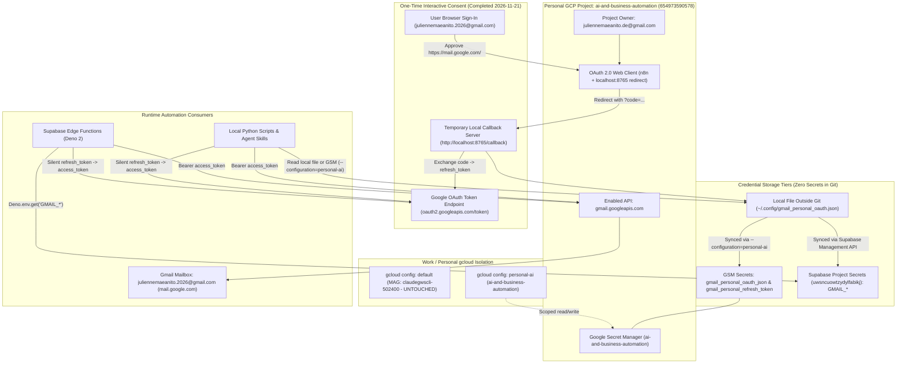
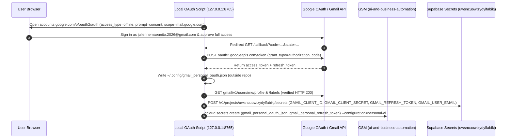
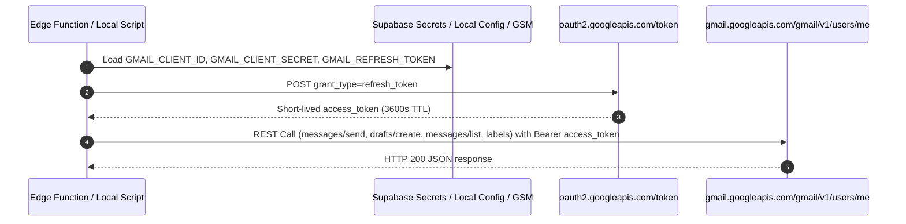

# Personal Gmail OAuth 2.0 Auth — System Architecture

> **Last updated:** 2026-11-21
> **Central Database / Core Platform:** Google Cloud (`ai-and-business-automation` / project `654973590578`) + Google Secret Manager + Supabase Edge Function Secrets (`uwsncuowtzydylfabikj`)
> **Scope:** Full-access (`https://mail.google.com/`) OAuth 2.0 credential lifecycle for personal Gmail (`juliennemaeanito.2026@gmail.com`) mirroring n8n's silent refresh-token pattern across local scripts, Google Secret Manager, and Supabase Edge Functions while staying strictly isolated from work (MAG) GCP credentials.

---

## 1. Executive Summary

To build automated Gmail workflows (drafting/sending tailored outreach with custom HTML signatures, labeling `sales_leads`, watching for replies and bounces) without relying on a paid n8n instance or exposing work mailboxes, personal Gmail credentials are provisioned using Google's standard **OAuth 2.0 offline refresh-token flow**—the exact same mechanism n8n uses under the hood.

1. **Stage 1 — GCP Project & OAuth Client (`ai-and-business-automation`):** A personal Google Cloud project owned by `juliennemaeanito.de@gmail.com` hosts the enabled **Gmail API** (`gmail.googleapis.com`) and a Web OAuth 2.0 client shared between n8n and local localhost OAuth callback authentication.
2. **Stage 2 — One-Time Interactive Consent Flow:** A local Python callback server (`http://localhost:8765/callback`) completes Google's browser consent screen with `access_type=offline&prompt=consent` for `juliennemaeanito.2026@gmail.com`, exchanging the single-use authorization code for a reusable `refresh_token`.
3. **Stage 3 — Three-Tier Secret Distribution (Zero Repo Secrets):** The resulting credential bundle (`client_id`, `client_secret`, `refresh_token`, `email`) is stored across three isolated destinations outside Git: a local user config file, Google Secret Manager in `ai-and-business-automation` (accessed via an isolated `personal-ai` `gcloud` configuration), and Supabase Edge Function Secrets (`uwsncuowtzydylfabikj`).
4. **Stage 4 — Silent Runtime Token Refresh:** At runtime, any local Python script, agent skill, or Supabase Edge Function posts `(client_id, client_secret, refresh_token, grant_type=refresh_token)` to `https://oauth2.googleapis.com/token` to mint a short-lived `access_token` (~1 hour) and call Gmail REST endpoints (`https://gmail.googleapis.com/gmail/v1/users/me/...`) with zero human interaction.

---

## 2. High-Level System Architecture

---

## 3. Execution Sequence / Lifecycle

### A. One-Time Provisioning & Secret Distribution (Completed `2026-11-21`)

### B. Ongoing Runtime Usage (Silent Token Refresh — Identical to n8n)

---

## 4. Stage-by-Stage Component Breakdown

### Stage 1: Google Cloud Project & OAuth Client
- **System / Runtime:** Google Cloud Platform (`ai-and-business-automation`, project number `654973590578`)
- **Owner Account:** `juliennemaeanito.de@gmail.com`
- **OAuth Client Type:** `web`
- **Authorized Redirect URIs:**
  - `https://n8n-659687081407.australia-southeast1.run.app/rest/oauth2-credential/callback` *(n8n Cloud Run)*
  - `http://localhost:8765/callback` *(local one-time consent capture)*
- **Enabled APIs:** `gmail.googleapis.com` (Gmail API), `secretmanager.googleapis.com` (Secret Manager API)
- **Source Client JSON (Local Download):** `C:\Users\Cloverly\Downloads\client_secret_654973590578-ptj2ehug1rg0cfcnfvqr65mtgh932dak.apps.googleusercontent.com.json` (also backed up in GSM as `oauth_outbound_sales_web_app_client_secret`)

### Stage 2: Authenticated Mailbox & Granted Scopes
- **Target Mailbox:** `juliennemaeanito.2026@gmail.com`
- **Granted Scopes:**
  - `https://mail.google.com/` *(full read, compose, send, modify, label, trash, and permanent delete access)*
  - `https://www.googleapis.com/auth/userinfo.email`
  - `openid`
- **Live Verification Snapshot (`2026-11-21`):**
  - Silent `refresh_token` → `access_token` exchange: **Verified (`HTTP 200`)**
  - Mailbox profile: `7` messages, `7` threads, `15` labels (custom user label present: `sales_leads`)

### Stage 3: Isolated `gcloud` CLI Configuration
- **Default Configuration (`default`, ACTIVE):**
  - Account: `julienne@myadventuregroup.com.au`
  - Project: `claudegwscli-502400`
  - Status: **Untouched** (all existing MAG scripts/skills keep working with zero side effects)
- **Personal Configuration (`personal-ai`, opt-in via `--configuration=personal-ai`):**
  - Account: `juliennemaeanito.de@gmail.com`
  - Project: `ai-and-business-automation`
  - Usage: `gcloud secrets versions access latest --secret=gmail_personal_oauth_json --configuration=personal-ai`

### Stage 4: Three-Tier Credential Storage
- **Tier 1 — Local Config File (Local Scripts / Agent Skills):**
  - Path: `C:\Users\Cloverly\.config\gmail_personal_oauth.json` (outside workspace & Git)
  - Schema keys: `email`, `project_id`, `client_id`, `client_secret`, `refresh_token`, `token_uri`, `scopes`
- **Tier 2 — Google Secret Manager (`ai-and-business-automation`):**
  - `gmail_personal_oauth_json` — full JSON payload matching the local config file
  - `gmail_personal_refresh_token` — raw `refresh_token` value
  - `oauth_outbound_sales_web_app_client_secret` — original downloaded OAuth client JSON (pre-existing)
- **Tier 3 — Supabase Edge Function Secrets (`uwsncuowtzydylfabikj`):**
  - `GMAIL_CLIENT_ID`, `GMAIL_CLIENT_SECRET`, `GMAIL_REFRESH_TOKEN`, `GMAIL_USER_EMAIL`
  - Accessed in any Edge Function via `Deno.env.get(...)`

---

## 5. External Data & Token Contract

### Token Refresh Request (`POST https://oauth2.googleapis.com/token`)

| Form Field (`application/x-www-form-urlencoded`) | Source Secret / Key | Purpose |
| --- | --- | --- |
| `client_id` | `GMAIL_CLIENT_ID` / `client_id` | Identifies the OAuth client in `ai-and-business-automation` |
| `client_secret` | `GMAIL_CLIENT_SECRET` / `client_secret` | Authenticates the Web OAuth client |
| `refresh_token` | `GMAIL_REFRESH_TOKEN` / `refresh_token` | Long-lived offline grant for `juliennemaeanito.2026@gmail.com` |
| `grant_type` | Literal `"refresh_token"` | Instructs Google to mint a fresh short-lived `access_token` |

### Gmail API Base Endpoints (Unlocked by `https://mail.google.com/`)

| Endpoint | HTTP Method | Planned Automation Use |
| --- | --- | --- |
| `/gmail/v1/users/me/profile` | `GET` | Health check & mailbox verification |
| `/gmail/v1/users/me/labels` | `GET` / `POST` | Resolve/manage `sales_leads` & outreach stage labels |
| `/gmail/v1/users/me/drafts` | `POST` | Create tailored intro drafts with custom HTML signature |
| `/gmail/v1/users/me/messages/send` | `POST` | Send cold outreach & threaded follow-ups |
| `/gmail/v1/users/me/messages` | `GET` / `POST .../modify` | Reply & bounce triage watcher (`8A` / `10A` / opt-out) |

---

## 6. Systems, Identifiers & Configuration Inventory

### External Resources & Endpoints

| System | Identifier / Endpoint | Role |
| --- | --- | --- |
| Personal GCP Project | `ai-and-business-automation` (`654973590578`) | Hosts Gmail API, OAuth client, and personal GSM secrets |
| Work GCP Project *(isolated)* | `claudegwscli-502400` | Default `gcloud` config for MAG — completely separate |
| OAuth Token Endpoint | `https://oauth2.googleapis.com/token` | Exchanges `refresh_token` for fresh `access_token` |
| Gmail REST API | `https://gmail.googleapis.com/gmail/v1/users/me/*` | Full mailbox operations for `juliennemaeanito.2026@gmail.com` |
| Supabase Project | `uwsncuowtzydylfabikj` | Hosts `GMAIL_*` Edge Function secrets for serverless automations |

### Secrets & Environment Variables Matrix (Names Only)

| Component | Required Var / Secret Names | Storage Location |
| --- | --- | --- |
| Local Python / Agent Automations | `email`, `client_id`, `client_secret`, `refresh_token`, `token_uri`, `scopes` | `C:\Users\Cloverly\.config\gmail_personal_oauth.json` (outside Git) |
| Personal GCP Backup / Cloud Run / CI | `gmail_personal_oauth_json`, `gmail_personal_refresh_token`, `oauth_outbound_sales_web_app_client_secret` | Google Secret Manager (`ai-and-business-automation`, `--configuration=personal-ai`) |
| Supabase Edge Functions | `GMAIL_CLIENT_ID`, `GMAIL_CLIENT_SECRET`, `GMAIL_REFRESH_TOKEN`, `GMAIL_USER_EMAIL` | Supabase Edge Function Secrets (`uwsncuowtzydylfabikj`) |

---

## 7. Key Operational Gotchas & Maintenance Notes

1. **7-Day Refresh Token Expiry in "Testing" Mode:** If the OAuth Consent Screen in `ai-and-business-automation` remains in **Testing** publishing status, Google automatically revokes refresh tokens every **7 days** (causing `invalid_grant` errors on silent refresh). Switch the OAuth Consent Screen to **In Production** to keep the refresh token long-lived like n8n (no public Google verification required for personal single-account use; just click through *"Advanced → Continue"* once if re-authorizing).
2. **Re-Syncing All Three Stores on Token Rotation:** If the `refresh_token` is ever revoked or re-issued, update **all three** destinations (`~/.config/gmail_personal_oauth.json`, GSM `gmail_personal_oauth_json` + `gmail_personal_refresh_token` in `ai-and-business-automation`, and `GMAIL_REFRESH_TOKEN` in Supabase `uwsncuowtzydylfabikj`) so local and cloud automations stay in sync.
3. **Never Activate `personal-ai` as Global Default Without Intent:** Always pass `--configuration=personal-ai` when calling `gcloud` against `ai-and-business-automation` so the active `default` configuration remains `julienne@myadventuregroup.com.au` / `claudegwscli-502400`.
4. **Full-Access Scope Caution (`https://mail.google.com/`):** This grant includes permanent message deletion (`messages.delete`). Downstream automation code should use `messages.trash` or label changes instead of hard deletes unless explicitly required.
5. **Cold-Email Deliverability Note:** Sending automated cold emails from a consumer `@gmail.com` address (`juliennemaeanito.2026@gmail.com`) has stricter daily sending limits and lower cold deliverability than a custom warmed domain with SPF/DKIM/DMARC. Keep initial outreach low-volume and personalized until a dedicated business domain is provisioned.
6. **Zero Secrets in Workspace Git:** Never copy `gmail_personal_oauth.json` or `client_secret_*.json` into `C:\Users\Cloverly\claude_code\upskilling\client_finder\`. Keep all raw credential files strictly in `~/.config/`, `~/Downloads/`, GSM, or Supabase Secrets.
