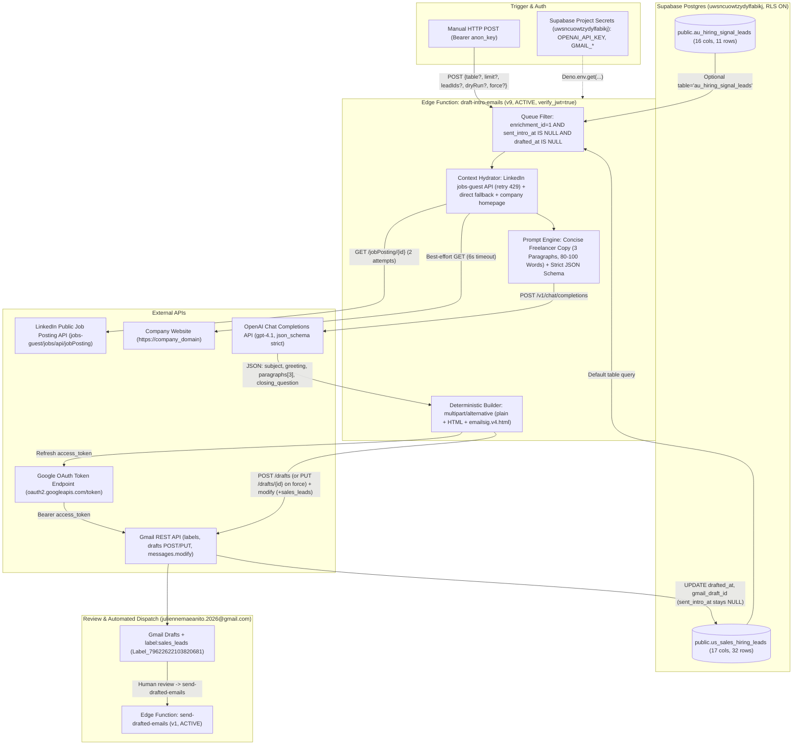
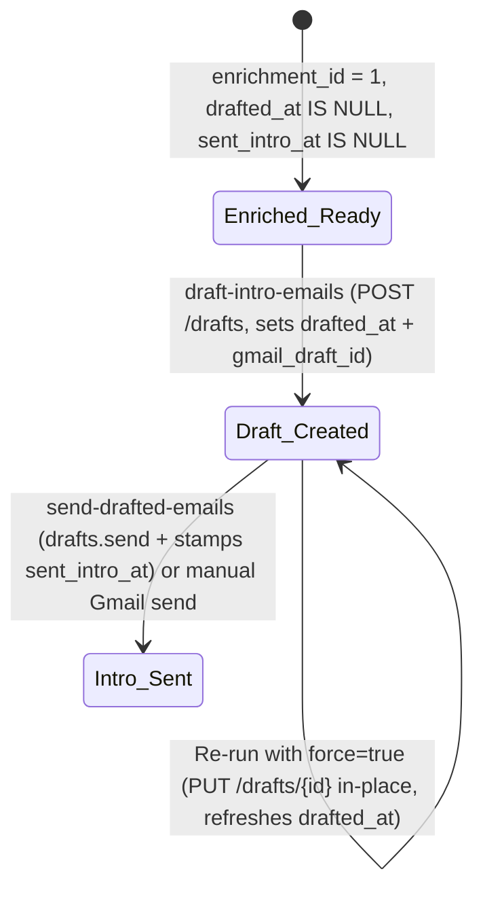

# Tailored Email Intro Drafting (`draft-intro-emails`) — System Architecture

> **Last updated:** 2026-11-23
> **Central Database / Core Platform:** Supabase (`uwsncuowtzydylfabikj`) — `public.us_sales_hiring_leads` & `public.au_hiring_signal_leads` + OpenAI (`gpt-4.1`) + Gmail API (`juliennemaeanito.2026@gmail.com`)
> **Scope:** Serverless cold-outreach drafting pipeline that pulls enriched, undrafted hiring leads from Supabase, fetches live LinkedIn job post descriptions and company context, generates concise (~80–100 word, 3-paragraph) persuasive freelancer intro emails via OpenAI structured JSON output, wraps them in clean HTML with `emailsig.v4.html`, creates or updates labeled Gmail drafts in-place under `label:sales_leads`, and stamps `drafted_at` + `gmail_draft_id` ahead of review and dispatch via `send-drafted-emails`.

---

## 1. Executive Summary

Once Stage 2 enrichment resolves a verified decision-maker email (`enrichment_id = 1`), manually researching each LinkedIn job listing, writing concise high-converting copy, formatting the custom HTML signature, and staging labeled Gmail drafts becomes the primary outreach bottleneck. `draft-intro-emails` automates drafting end-to-end while keeping a **human-in-the-loop review gate** before dispatch (leaving `sent_intro_at = NULL` until sent manually in Gmail or via `send-drafted-emails`):

1. **Stage 1 — Enriched Queue Selection (`public.us_sales_hiring_leads` / `public.au_hiring_signal_leads`):** Queries rows with `enrichment_id = 1`, `email IS NOT NULL`, `sent_intro_at IS NULL`, and `drafted_at IS NULL` (unless `force: true`), bounded by `limit` (default `10`, max `25`).
2. **Stage 2 — Live Context Hydration (LinkedIn Job Post + Company Homepage):** Extracts the numeric LinkedIn Job ID from `job_url`, fetches the public guest job endpoint (`linkedin.com/jobs-guest/jobs/api/jobPosting/{jobId}`) with HTTP `429`/`5xx` retry + direct `job_url` fallback, and pulls a lightweight best-effort summary from `https://{company_domain}`.
3. **Stage 3 — Concise Persuasive Copy Generation (OpenAI `gpt-4.1` Strict JSON Schema):** Sends the lead record, scraped LinkedIn posting, and company summary to OpenAI Chat Completions with `strict: true` JSON Schema output (`subject`, `greeting`, `paragraphs[3]`, `closing_question`). Enforces **~80–100 words across 3 tight paragraphs** (~half the length of the original v5 emails), a peer-to-peer professional freelancer voice, industry-agnostic proof (*"for one of my clients"* saving ~40 hrs/week — never naming an unrelated niche), loss-aversion framing on manual admin drag, and a zero-friction reciprocity/autonomy CTA (15-min call or 2-min walkthrough).
4. **Stage 4 — Deterministic MIME Assembly & In-Place Gmail Draft Upsert:** Escapes plain-text paragraphs, assembles clean `<div dir="ltr">` HTML with `emailsig.v4.html` plus a matching `text/plain` part in RFC 2822 `multipart/alternative` format, refreshes Gmail OAuth (`GMAIL_*`), updates an existing draft in-place via `PUT /users/me/drafts/{id}` when `force: true` and `gmail_draft_id` exists (falling back to `POST /users/me/drafts` on 404 or new leads), and ensures `label:sales_leads` (`Label_79622622103820681`) is attached via `messages.modify`.
5. **Stage 5 — Idempotency Tracking & Dispatch Handoff:** Stamps `drafted_at = now()` and `gmail_draft_id` on the Supabase lead row (keeping `sent_intro_at = NULL`) and returns `body_word_count`, `plain_preview`, and `gmail_draft_action` (`"created"` | `"updated"`). Ready drafts are then reviewed in Gmail under `label:sales_leads` and sent either manually or via `send-drafted-emails` (see `6_system_architecture_send_drafted_emails.md`).

---

## 2. High-Level System Architecture



---

## 3. Execution Sequence / Lifecycle

```mermaid
sequenceDiagram
    autonumber
    participant Op as Operator / Caller
    participant EF as Edge Function ("draft-intro-emails" v9)
    participant DB as Supabase Postgres ("us_sales_hiring_leads")
    participant LI as LinkedIn Public Job API & Company Site
    participant OAI as OpenAI API ("gpt-4.1")
    participant Google as Google OAuth & Gmail API

    Op->>EF: POST /functions/v1/draft-intro-emails ({ table?, limit?, leadIds?, dryRun?, force? })
    EF->>DB: SELECT * WHERE enrichment_id = 1 AND sent_intro_at IS NULL [AND drafted_at IS NULL] LIMIT N
    DB-->>EF: Queued lead rows

    alt dryRun = false AND queued > 0
        EF->>Google: POST oauth2.googleapis.com/token (grant_type=refresh_token)
        Google-->>EF: Short-lived access_token
        EF->>Google: GET /gmail/v1/users/me/labels (resolve or create sales_leads)
        Google-->>EF: labelId (Label_79622622103820681)
    end

    loop For each queued lead
        EF->>LI: GET jobs-guest/jobs/api/jobPosting/{jobId} (retry 429/5xx; fallback direct job_url)
        LI-->>EF: Job title, criteria, full description
        EF->>LI: Best-effort GET https://{company_domain} (6s timeout)
        LI-->>EF: Homepage title, meta description, excerpt
        EF->>OAI: POST /v1/chat/completions (gpt-4.1, 3-paragraph concise freelancer schema)
        OAI-->>EF: { subject, greeting, paragraphs[3], closing_question }
        Note over EF: Escape text -> build multipart/alternative MIME (plain + HTML + emailsig.v4.html)

        alt dryRun = false
            alt force = true AND existing gmail_draft_id
                EF->>Google: PUT /gmail/v1/users/me/drafts/{existingDraftId} (fallback POST on 404)
            else new draft
                EF->>Google: POST /gmail/v1/users/me/drafts ({ message: { raw: base64url } })
            end
            Google-->>EF: { id: draftId, message: { id: messageId } }
            EF->>Google: POST /gmail/v1/users/me/messages/{messageId}/modify ({ addLabelIds: [labelId] })
            Google-->>EF: labelIds: ["DRAFT", "Label_79622622103820681"]
            EF->>DB: UPDATE SET drafted_at = now(), gmail_draft_id = draftId WHERE id = lead.id
            Note over DB: BEFORE UPDATE trigger auto-refreshes updated_at
        end
    end

    EF-->>Op: HTTP 200 JSON report (counts, drafts[] with body_word_count + plain_preview, errors[])
```

---

## 4. Stage-by-Stage Component Breakdown

### Stage 1: Trigger, Validation & Queue Selection (`draft-intro-emails`)
- **System / Runtime:** Supabase Edge Function (Deno 2, `npm:@supabase/supabase-js@2`, native `fetch`)
- **Endpoint / Source Path:**
  - Live URL: `https://uwsncuowtzydylfabikj.supabase.co/functions/v1/draft-intro-emails` (**v9, `ACTIVE`, `verify_jwt: true`**, ID `69bdde2e-27f2-44ad-aa5e-914382d3485a`)
  - Source: `supabase/functions/draft-intro-emails/index.ts`
  - Specification Prompt: `prompts/261121_email_intro_edge_function.txt`
- **Trigger / Live Schedule:** Manual HTTP `POST` (`GET` returns health status, active defaults, and boolean `env_ready` flags). No `pg_cron` schedule attached.
- **Queue / Input Filter:**
  - Strict table allowlist: `us_sales_hiring_leads` (default) or `au_hiring_signal_leads`.
  - Default SQL filter: `enrichment_id = 1 AND sent_intro_at IS NULL AND email IS NOT NULL AND drafted_at IS NULL` ordered by `created_at DESC`, capped at `limit` (default `10`, clamped `1..25`).
  - Optional overrides: `leadIds` (`uuid[]`), `force: true` (includes already-drafted rows and updates existing Gmail drafts in-place), `dryRun: true` (returns `plain_preview` + `body_word_count` without calling Gmail or updating Postgres), `label` (default `"sales_leads"`), `model` (default `"gpt-4.1"`).

### Stage 2: LinkedIn Job Post & Company Context Hydration
- **System / Runtime:** Inside `draft-intro-emails` (`fetchJobPostContext`)
- **Processing Logic:**
  1. Extracts numeric LinkedIn Job ID from `lead.job_url` via regex (`jobs/view/...-{id}` or `currentJobId={id}`).
  2. Calls `https://www.linkedin.com/jobs-guest/jobs/api/jobPosting/{jobId}` using realistic browser headers with `fetchWithRetry` (up to 2 attempts with 1.5s backoff on HTTP `429` or `5xx`, 12s timeout).
  3. Parses HTML deterministically for `top-card-layout__title`, `description__job-criteria-item`, and `show-more-less-html__markup` (capped at 6,000 chars).
  4. Falls back to fetching `lead.job_url` directly if the guest API returns an empty/short description.
  5. Performs a best-effort `GET https://{company_domain}` (6s timeout) to capture `<title>`, `<meta name="description">`, and a 1,200-char body excerpt.

### Stage 3: Concise Persuasive Email Copy Generation (OpenAI `gpt-4.1`)
- **System / Runtime:** OpenAI Chat Completions REST API (`https://api.openai.com/v1/chat/completions`, `temperature: 0.6`, 45s timeout)
- **Copy Strategy (Updated v6–v9):**
  1. Enforces strict JSON Schema output (`strict: true`, `additionalProperties: false`) returning `{ subject, greeting, paragraphs[3], closing_question }`.
  2. **Half-Length Target (~80–100 words across 3 paragraphs):** Cut from the original ~165–190 word, 4-paragraph format down to 3 punchy paragraphs.
  3. **Relevance + Loss Aversion (Para 1):** Opens directly on the verified LinkedIn job post and frames how manual outbound/CRM admin quietly pulls hours away from selling and relationship-building (never fabricating unsupported facts).
  4. **Industry-Agnostic Social Proof + Tailored Bridge (Para 2):** Explicitly omits `"for a travel company"` and instead cites *"a 30+ workflow automation system for one of my clients that saves their team around 40 hours a week"*, bridged naturally to implementing a similar setup for the recipient's team.
  5. **Reciprocity + Autonomy CTA (Para 3):** Offers to map out 2–3 workflows they can automate right away via a quick 15-minute call **or** a short 2-minute walkthrough if they prefer to skip a meeting — *"yours to keep either way, no strings attached."* Appends a brief routing note only for HR/People/Talent/Client Services/non-Sales/non-Executive titles.

### Stage 4: Deterministic MIME Builder & In-Place Labeled Gmail Draft Upsert
- **System / Runtime:** Gmail REST API (`https://gmail.googleapis.com/gmail/v1/users/me/*`) via Personal Gmail OAuth 2.0 (`juliennemaeanito.2026@gmail.com`)
- **Signature Template Source:** Clean inline-table HTML matching `email_signature/emailsig.v4.html` + `EMAIL_SIGNATURE_PLAIN`.
- **Processing Logic:**
  1. Escapes LLM plain-text paragraphs via `escapeHtml()`, builds `<div dir="ltr">` HTML + matching `text/plain` body (`buildEmailBodies`), and computes `bodyWordCount`.
  2. Encodes RFC 2822 `multipart/alternative` MIME message (Base64 UTF-8 body parts, RFC 2047 UTF-8 header encoding, Base64url envelope).
  3. Refreshes `access_token` at `oauth2.googleapis.com/token` and resolves/creates `sales_leads` (`Label_79622622103820681`).
  4. **In-Place Update (v8+):** When `force: true` and `lead.gmail_draft_id` is set, calls `PUT /users/me/drafts/{existingDraftId}` so re-drafts overwrite the existing Gmail draft without creating duplicates (falling back to `POST /users/me/drafts` on HTTP `404`).
  5. Attaches `sales_leads` to `draft.message.id` via `POST /users/me/messages/{messageId}/modify` (`{ addLabelIds: [labelId] }`).
- **Outputs & Handoff Signal:** Stamps `drafted_at = now()` and `gmail_draft_id = draft.id` while leaving `sent_intro_at = NULL`. Downstream dispatch and `sent_intro_at` stamping are handled by `send-drafted-emails` (v1) or manual send in Gmail.

---

## 5. Central Data Contract (Database Schema & State Machine)

### Migration Applied (`2026-11-21`)
- `supabase/migrations/20261121_add_draft_columns_to_hiring_leads.sql` added `drafted_at` (`timestamptz`), `gmail_draft_id` (`text`), and partial queue indexes (`idx_us_sales_hiring_leads_draft_queue`, `idx_au_hiring_signal_leads_draft_queue`) to both `public.us_sales_hiring_leads` (**17 columns**) and `public.au_hiring_signal_leads` (**16 columns**).

### Key Columns Read & Written by `draft-intro-emails`

| Column | Type | Nullable / Default | Written By | Read By | Purpose |
| --- | --- | --- | --- | --- | --- |
| `id` | `uuid` | `NO` / `gen_random_uuid()` | Postgres | `draft-intro-emails`, `send-drafted-emails` | Update key & optional `leadIds` filter |
| `company` | `text` | `NO` / — | Discovery Edge Functions | `draft-intro-emails` | Email copy personalization |
| `poc_name` | `text` | `NO` / — | Discovery Edge Functions | `draft-intro-emails` | First-name greeting & `To:` display name |
| `poc_role` | `text` | `NO` / — | Discovery Edge Functions | `draft-intro-emails` | Tone & conditional routing-line logic |
| `company_domain` | `text` | `YES` / `NULL` | Discovery Edge Functions | `draft-intro-emails` | Best-effort company homepage context fetch |
| `hiring_role` | `text` | `YES` / `NULL` | Discovery Edge Functions | `draft-intro-emails` | LinkedIn hiring signal hook |
| `job_location` *(US table only)* | `text` | `YES` / `NULL` | `us-sales-hiring-leads` | `draft-intro-emails` | Geographic context in copy |
| `job_url` | `text` | `YES` / `NULL` | Discovery Edge Functions | `draft-intro-emails` | LinkedIn Job ID extraction & fallback fetch |
| `email` | `text` | `YES` / `NULL` | `enrich-hiring-leads` | `draft-intro-emails`, `send-drafted-emails` | Gmail `To:` address & fallback sync key |
| `enrichment_id` | `integer` | `YES` / `NULL` | `enrich-hiring-leads` | `draft-intro-emails` | Queue filter (`= 1`) |
| `drafted_at` | `timestamptz` | `YES` / `NULL` | `draft-intro-emails` | `draft-intro-emails` | Idempotency guard (`IS NULL` unless `force: true`) |
| `gmail_draft_id` | `text` | `YES` / `NULL` | `draft-intro-emails` | `draft-intro-emails` (`force` PUT), `send-drafted-emails` | Gmail Draft ID (`r...`) for in-place updates & send sync |
| `sent_intro_at` | `timestamptz` | `YES` / `NULL` | `send-drafted-emails` / manual | `draft-intro-emails` | Queue exclusion (`IS NULL`) |
| `updated_at` | `timestamptz` | `NO` / `now()` | `BEFORE UPDATE` trigger | Audit | Auto-refreshed on `drafted_at` / `sent_intro_at` updates |

### Lead Drafting & Outreach State Machine



### Live Snapshot Volume (Queried `2026-11-23`)

| Table | Total | `enrichment_id = 1` | `enrichment_id = 2` | Unenriched | Drafted (`drafted_at` Set) | Sent (`sent_intro_at` Set) | Ready to Draft | Drafted Awaiting Send |
| --- | ---: | ---: | ---: | ---: | ---: | ---: | ---: | ---: |
| `public.us_sales_hiring_leads` | **32** | 6 | 26 | 0 | **3** | **6** | **0** | **0** |
| `public.au_hiring_signal_leads` | **11** | 1 | 0 | 10 | **0** | **1** | **0** | **0** |

---

## 6. External Data Mappings

### Request Contract (`POST /functions/v1/draft-intro-emails`)

| Request Field | Type / Default | Behavior |
| --- | --- | --- |
| `table` | `string` / `"us_sales_hiring_leads"` | Allowlisted to `us_sales_hiring_leads` or `au_hiring_signal_leads` |
| `limit` | `number` / `10` | Clamped `1..25` rows per invocation |
| `leadIds` / `lead_ids` | `string[]` / `[]` | Optional UUID filter to target specific leads |
| `label` | `string` / `"sales_leads"` | Gmail label attached to every created/updated draft |
| `model` | `string` / `"gpt-4.1"` | OpenAI Chat Completions model ID |
| `dryRun` / `dry_run` | `boolean` / `false` | Runs scraping + OpenAI generation and returns `plain_preview` + `body_word_count` without calling Gmail or updating Postgres |
| `force` | `boolean` / `false` | Includes rows where `drafted_at IS NOT NULL` and updates existing `gmail_draft_id` in-place via `PUT` |

### OpenAI Structured Output → Gmail MIME Mapping

| OpenAI JSON Field | Transformation | Target Destination |
| --- | --- | --- |
| `subject` | RFC 2047 UTF-8 MIME header encoding | Gmail `Subject:` header |
| `greeting` | HTML-escaped + `<br><br>` | First line of HTML & plain body |
| `paragraphs[0..2]` | HTML-escaped, joined by `<br><br>` (~80–100 words total) | 3 concise tailored body paragraphs |
| `closing_question` | HTML-escaped + `<br><br>Best,<br>` + `emailsig.v4.html` | Closing nudge before signature |

---

## 7. Systems, Identifiers & Configuration Inventory

### External Resources & Endpoints

| System | Identifier / Endpoint | Role |
| --- | --- | --- |
| Supabase Project | `uwsncuowtzydylfabikj` (`https://uwsncuowtzydylfabikj.supabase.co`) | Postgres DB + Edge Function host |
| Drafting Edge Function | `https://uwsncuowtzydylfabikj.supabase.co/functions/v1/draft-intro-emails` | Live **v9** (`ACTIVE`, `verify_jwt: true`, ID `69bdde2e-27f2-44ad-aa5e-914382d3485a`) |
| Downstream Sending Edge Function | `https://uwsncuowtzydylfabikj.supabase.co/functions/v1/send-drafted-emails` | Live **v1** (`ACTIVE`, `verify_jwt: true`, ID `5c286d33-391f-4931-b4d5-b2b461d0a4e0`) |
| LinkedIn Public Job API | `https://www.linkedin.com/jobs-guest/jobs/api/jobPosting/{jobId}` | Unauthenticated HTML job posting retrieval |
| OpenAI API | `https://api.openai.com/v1/chat/completions` | Structured JSON email drafting (`gpt-4.1`) |
| Google OAuth Token API | `https://oauth2.googleapis.com/token` | Silent `refresh_token` → `access_token` exchange |
| Gmail REST API | `https://gmail.googleapis.com/gmail/v1/users/me/{labels,drafts,messages}` | Draft creation/in-place `PUT` & `sales_leads` (`Label_79622622103820681`) attachment |

### Active Schedules / Cron Table

| Job Name | Cron (UTC) | Local Time (UTC+8) | Target | Status |
| --- | --- | --- | --- | --- |
| *(None for `draft-intro-emails`)* | — | — | `draft-intro-emails` | Manual HTTP `POST` trigger only |
| *(35 unrelated `pg_cron` jobs on `uwsncuowtzydylfabikj`)* | Various | Various | Unrelated n8n workflows (`33` active, `2` inactive) | Untouched (outside Client Finder scope) |

### Secrets & Environment Variables Matrix (Names Only)

| Component | Required Var / Secret Names | Storage Location |
| --- | --- | --- |
| `draft-intro-emails` (Supabase DB) | `SUPABASE_URL`, `SUPABASE_SERVICE_ROLE_KEY` | Auto-injected by Supabase Edge Runtime (`uwsncuowtzydylfabikj`) |
| `draft-intro-emails` (OpenAI LLM) | `OPENAI_API_KEY` | Supabase Edge Function Secrets (`uwsncuowtzydylfabikj`) |
| `draft-intro-emails` (Gmail OAuth) | `GMAIL_CLIENT_ID`, `GMAIL_CLIENT_SECRET`, `GMAIL_REFRESH_TOKEN`, `GMAIL_USER_EMAIL` | Supabase Edge Function Secrets (`uwsncuowtzydylfabikj`), mirrored in GCP Secret Manager (`ai-and-business-automation`) & `~/.config/gmail_personal_oauth.json` |
| Unused / Depleted Secret *(note)* | `GEMINI_API_KEY` | Present in Supabase Secrets (`uwsncuowtzydylfabikj`), unused by `draft-intro-emails` due to HTTP 402 depleted AI Studio credits |
| HTTP Caller Auth | `SUPABASE_ANON_KEY` | Fetched dynamically via Supabase Management API (`SUPABASE_ACCESS_TOKEN`) |

---

## 8. Key Operational Gotchas & Maintenance Notes

1. **LLM Provider Switch (`GEMINI_API_KEY` HTTP 402 → `OPENAI_API_KEY`):** Initial v1 used Gemini (`gemini-3.8-flash`), which returned HTTP `402 RESOURCE_EXHAUSTED`. v4–v9 use OpenAI `gpt-4.1` via `OPENAI_API_KEY`.
2. **Intermittent LinkedIn HTTP `429` Rate Limiting:** LinkedIn occasionally returns HTTP `429` on datacenter IPs for `jobs-guest/jobs/api/jobPosting/{jobId}`. `fetchWithRetry` (2 attempts, 1.5s backoff) + direct `job_url` fallback + company homepage fetch mitigated this (`3/3` succeeded via `linkedin_guest_api` in v9). Keep `limit <= 10` per call to avoid rate-limit bursts or Supabase's 150s gateway timeout.
3. **In-Place Draft Updates on Re-Runs (v8+):** Re-running with `force: true` updates the lead's existing `gmail_draft_id` in-place via `PUT /users/me/drafts/{id}` (avoiding duplicate drafts in Gmail), falling back to `POST /users/me/drafts` only if the old draft was deleted (`404`).
4. **Two-Step Draft Labeling:** `POST`/`PUT /users/me/drafts` is always followed by `POST /users/me/messages/{draft.message.id}/modify` (`addLabelIds: [salesLeadsLabelId]`) so drafts appear immediately under both **Drafts** and `label:sales_leads`.
5. **Automated Dispatch & `sent_intro_at` Sync Now Solved:** `send-drafted-emails` (v1) now sends drafts under `label:sales_leads` and automatically stamps `sent_intro_at` on `us_sales_hiring_leads` / `au_hiring_signal_leads` (verified live `2026-11-22`: all 3 `us_sales_hiring_leads` drafts sent and stamped). If an operator manually sends a draft directly in the Gmail UI instead of calling `send-drafted-emails`, `sent_intro_at` must still be updated manually.
6. **Gmail OAuth Refresh Token 7-Day Expiry Risk:** Ensure the OAuth Consent Screen in GCP project `ai-and-business-automation` (`654973590578`) is published **In Production** so `GMAIL_REFRESH_TOKEN` does not expire every 7 days.
7. **Live Function Inventory (7 Active Functions on `uwsncuowtzydylfabikj`):** `hiring-signal-leads` (v9), `us-sales-hiring-leads` (v6), `enrich-hiring-leads` (v4), `draft-intro-emails` (v9), `enrich-autodoc-employees` (v3), `draft-intro-emails-dk` (v5), and `send-drafted-emails` (v1).
