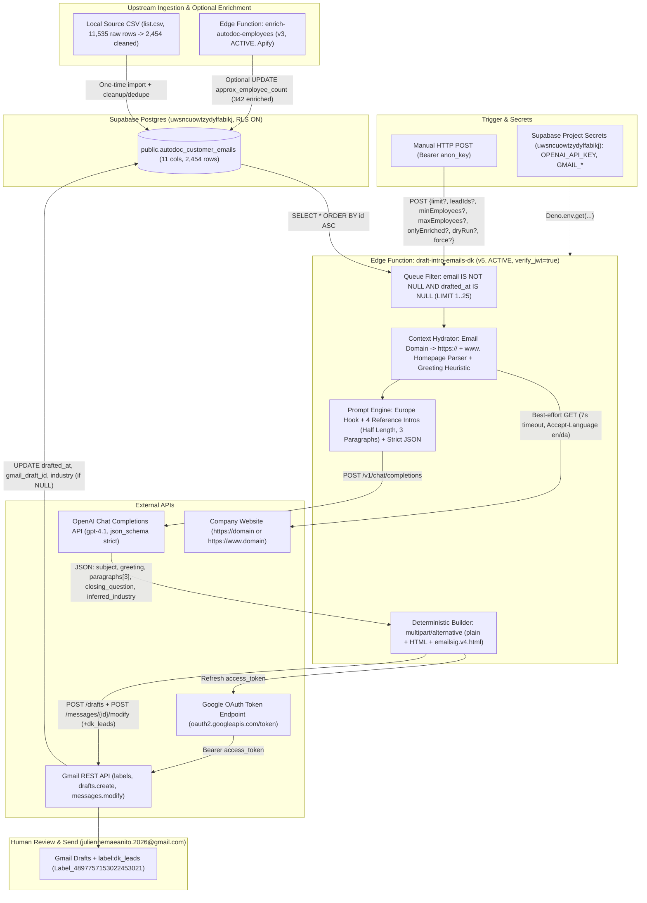
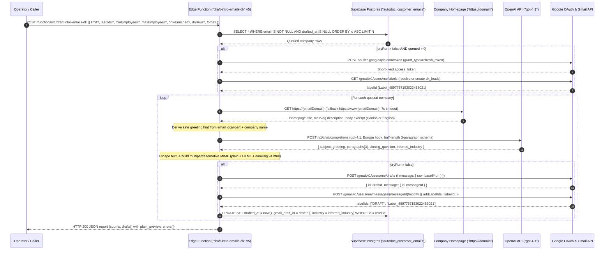
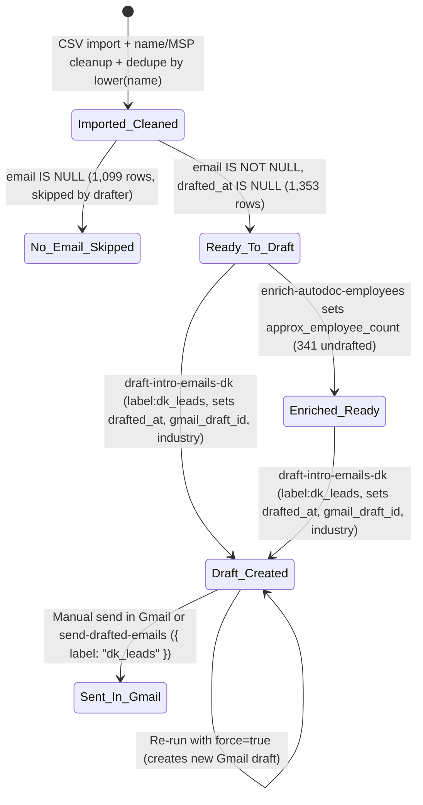

# Danish / European Leads Intro Email Drafting (`draft-intro-emails-dk`) — System Architecture

> **Last updated:** 2026-11-23
> **Central Database / Core Platform:** Supabase (`uwsncuowtzydylfabikj`) — `public.autodoc_customer_emails` + OpenAI (`gpt-4.1`) + Gmail API (`juliennemaeanito.2026@gmail.com`)
> **Scope:** Serverless cold-outreach drafting pipeline for cleaned Danish/European B2B leads in `public.autodoc_customer_emails` that fetches live company homepage context, derives safe recipient greetings from email addresses, generates concise (~half-length, 75–100 word) reference-mirrored intro emails via OpenAI structured JSON output, wraps them in `emailsig.v4.html`, saves labeled Gmail drafts under `label:dk_leads` (`Label_4897757153022453021`), and stamps `drafted_at`, `gmail_draft_id`, and inferred `industry` for human-in-the-loop review.

---

## 1. Executive Summary

Unlike the hiring-signal outreach pipeline (`draft-intro-emails`, documented in `4_system_architecture_email_intro_drafting.md`), the Danish/European dataset in `public.autodoc_customer_emails` originates from a cleaned AutoDoc/IT Relation customer export (`list.csv`, deduplicated from `11,535` raw rows down to `2,454` unique companies with at most one non-MSP email per company) and has **no LinkedIn job posting** or structured POC name/title columns. `draft-intro-emails-dk` is a dedicated, decoupled Supabase Edge Function tailored specifically to this schema and isolated into its own Gmail label (`label:dk_leads`, separate from `label:sales_leads` used by US/AU hiring leads):

1. **Stage 1 — Upstream Table Preparation & Optional Headcount Enrichment:** Raw rows from `list.csv` were imported into `public.autodoc_customer_emails`, cleaned of operational tags (`DO NOT USE`, `BRUG/USE <id>`, `UNDER KONKURS`, `spærret`, etc.) and MSP/vendor email domains, deduplicated to 1 row per `lower(name)`, and optionally enriched for `approx_employee_count` via `enrich-autodoc-employees` (v3, Apify `automation-lab~linkedin-company-scraper`).
2. **Stage 2 — Undrafted Queue Selection (`draft-intro-emails-dk`):** Queries `public.autodoc_customer_emails` where `email IS NOT NULL AND drafted_at IS NULL` (unless `force: true`), bounded by `limit` (default `10`, clamped `1..25`), with optional targeting filters (`leadIds`, `onlyEnriched`, `minEmployees`, `maxEmployees`).
3. **Stage 3 — Live Company Website Hydration & Greeting Derivation:** Extracts the corporate domain from `email` (skipping free webmail), fetches `https://{domain}` (with `https://www.{domain}` fallback, 7s timeout) to read Danish or English `<title>`, `<meta name="description">`/`og:description`, and body excerpt, and deterministically computes a safe greeting hint (`Hi Morten,` for clear first names, `Hi [Company] team,` for generic inboxes like `info@`, or `Hi there,` for initials like `mg@`).
4. **Stage 4 — Concise Reference-Mirrored Copy Generation (OpenAI `gpt-4.1` Strict JSON Schema):** Sends the company fields, live homepage context, greeting hint, and all 4 manually sent reference intros (`manually_sent_intros/`) to OpenAI Chat Completions with `strict: true` JSON Schema output (`subject`, `greeting`, `paragraphs[3]`, `closing_question`, `inferred_industry`), opening with a European discovery hook and enforcing ~half the length of the reference emails (**~75–100 words across 3 short paragraphs** — retaining the exact `Trehøje Døre A/S` prompt style).
5. **Stage 5 — Deterministic MIME Assembly, Labeled Gmail Draft Creation & DB Stamping:** Builds an RFC 2822 `multipart/alternative` message (`text/plain` + `
` HTML wrapping `emailsig.v4.html`), refreshes the personal Gmail OAuth token (`GMAIL_*`), creates the draft via `drafts.create`, attaches **`label:dk_leads`** (`Label_4897757153022453021`) via `messages.modify`, and stamps `drafted_at`, `gmail_draft_id`, and (when null) `industry` on the matched row.

---

## 2. High-Level System Architecture

---

## 3. Execution Sequence / Lifecycle

---

## 4. Stage-by-Stage Component Breakdown

### Stage 1: Trigger, Validation & Queue Selection (`draft-intro-emails-dk`)
- **System / Runtime:** Supabase Edge Function (Deno 2, `npm:@supabase/supabase-js@2`, native `fetch`)
- **Endpoint / Source Path:**
  - Live URL: `https://uwsncuowtzydylfabikj.supabase.co/functions/v1/draft-intro-emails-dk` (**v5, `ACTIVE`, `verify_jwt: true`**, Function ID `0e4c80e0-5d4f-4368-b621-d0db5e13eb56`)
  - Source: `supabase/functions/draft-intro-emails-dk/index.ts`
  - Specification Prompt: `prompts/261121_draft_email_intro_edge_function_dk_leads.txt`
- **Trigger / Live Schedule:** Manual HTTP `POST` (`GET` returns health status, `env_ready` boolean flags, `default_label: "dk_leads"`, and live `queue_stats`). No `pg_cron` schedule attached.
- **Queue / Input Filter:**
  - Table: hardcoded to `public.autodoc_customer_emails`.
  - Default SQL filter: `email IS NOT NULL AND drafted_at IS NULL` ordered by `id ASC`, capped at `limit` (default `10`, clamped `1..25`).
  - Optional filters/overrides: `leadIds` (`number[]`), `onlyEnriched` (`boolean`), `minEmployees` / `maxEmployees` (`number`), `force` (`boolean`, default `false`), `dryRun` (`boolean`, default `false`), `label` (default `"dk_leads"`), `model` (default `"gpt-4.1"`).

### Stage 2: Company Homepage Hydration & Greeting Derivation
- **System / Runtime:** Inside `draft-intro-emails-dk` (`fetchCompanyContext` + `deriveGreetingHint`)
- **Processing Logic:**
  1. `extractCorporateDomain(lead.email)` extracts the domain after `@` and ignores `25` common free/ISP webmail domains.
  2. `fetchCompanyContext` requests `https://{domain}` first and falls back to `https://www.{domain}` on error/non-HTML/minimal content (7s timeout per attempt, `Accept-Language: en-US,en;q=0.9,da;q=0.8`).
  3. Parses HTML deterministically for `<title>` (max 200 chars), `<meta name="description">` / `og:description` (max 400 chars), and cleaned `<body>` text (max 1,800 chars).
  4. `deriveGreetingHint(email, companyName)` derives safe greetings: generic inboxes (`info@`, `salg@`, `kontakt@`, etc.) → `Hi <Short Company> team,`; clear personal first names (`morten@`, `claus@`, `anders.lindberg@`) → `Hi <FirstName>,`; initials (`mg@`, `vh@`, `tdc@`, `c.hansen@`) → `Hi there,`.

### Stage 3: Concise Reference-Mirrored Copy Generation (OpenAI `gpt-4.1`)
- **System / Runtime:** OpenAI Chat Completions REST API (`https://api.openai.com/v1/chat/completions`, `temperature: 0.6`, 45s timeout)
- **Reference Corpus Embedded in System Prompt:** All 4 manually sent emails from `manually_sent_intros/` (`ResQ`, `WOW Recruitment`, `SuitePad`, `Homeland Talent Solutions`) paired with the European discovery-hook and half-length rules (locked to the exact v2 prompt style that generated `Trehøje Døre A/S`, `r106169469293907930`).
- **Processing Logic:**
  1. Enforces strict JSON Schema (`strict: true`, `additionalProperties: false`) returning `{ subject, greeting, paragraphs[3], closing_question, inferred_industry }`.
  2. Opens Paragraph 1 naturally with a European discovery hook grounded strictly in the company's live website/name (reading Danish natively, writing fluent English) without fabricating facts or mentioning LinkedIn job posts.
  3. Enforces ~75–100 words across 3 concise paragraphs, drops Danish/European legal suffixes (`A/S`, `ApS`, `I/S`, `K/S`, `P/S`) in prose/subjects, preserves Julienne's voice (` — `, `2–3`, `30+ workflow system` / `~40 hours a week`, `Worth a look?`), and appends a brief routing note only for generic/unknown-role recipients.

### Stage 4: Deterministic MIME Builder, Labeled Gmail Draft Creation & DB Stamping
- **System / Runtime:** Gmail REST API (`https://gmail.googleapis.com/gmail/v1/users/me/*`) via Personal Gmail OAuth 2.0 (`juliennemaeanito.2026@gmail.com`)
- **Signature Template Source:** Clean inline-table HTML matching `email_signature/emailsig.v4.html` + `EMAIL_SIGNATURE_PLAIN`.
- **Processing Logic:**
  1. Escapes LLM plain-text paragraphs, builds `
` HTML + matching `text/plain` body (`buildEmailBodies`), and computes `bodyWordCount`.
  2. Encodes RFC 2822 `multipart/alternative` MIME message (Base64 UTF-8 body parts, RFC 2047 UTF-8 header encoding for Danish characters like `ø`/`æ`/`å`).
  3. Refreshes Gmail OAuth `access_token` and resolves/creates **`dk_leads`** (`Label_4897757153022453021`).
  4. Creates the draft via `POST /users/me/drafts` and attaches `dk_leads` via `POST /users/me/messages/{draft.message.id}/modify` (`{ addLabelIds: [labelId] }`).
- **Outputs & Handoff Signal:** Updates `public.autodoc_customer_emails` with `drafted_at = now()`, `gmail_draft_id = draft.id`, and backfills `industry` when `NULL`. Both initial test drafts (`Advicer` `r1689643320746651605` and `Trehøje Døre A/S` `r106169469293907930`) were transferred from `sales_leads` to `dk_leads` on `2026-11-23`, isolating DK drafts from `send-drafted-emails` default `sales_leads` runs.

---

## 5. Central Data Contract (Database Schema & State Machine)

### Migrations & Live Schema State
- `supabase/migrations/20261121_create_autodoc_customer_emails.sql`: Created `public.autodoc_customer_emails` with RLS enabled and 3 initial indexes (`auto_doc_asset_id`, `nav_customer_id`, partial `email`).
- `supabase/migrations/20261121_add_draft_index_to_autodoc_customer_emails.sql`: Documented `approx_employee_count`, `industry`, `drafted_at`, `gmail_draft_id` (`ADD COLUMN IF NOT EXISTS`) and created partial queue index `idx_autodoc_customer_emails_draft_queue` (`WHERE email IS NOT NULL AND drafted_at IS NULL`).
- Live unique index `idx_autodoc_customer_emails_lower_name` on `(lower(name))` enforces 1 row / 1 email per unique cleaned company name.
- **RLS & Triggers (verified live `2026-11-23`):** `relrowsecurity = true`, `0` public/anon policies, `0` triggers.

### Full Column Contract (`public.autodoc_customer_emails` — 11 Columns)

| Column | Type | Nullable / Default | Written By | Read By | Purpose |
| --- | --- | --- | --- | --- | --- |
| `id` | `bigint` | `NO` / `GENERATED ALWAYS AS IDENTITY` (PK) | Postgres | `draft-intro-emails-dk`, `enrich-autodoc-employees` | Row key, `ORDER BY id ASC`, optional `leadIds` filter |
| `auto_doc_asset_id` | `bigint` | `NO` / — | CSV importer | Audit / upstream reference | Original AutoDoc asset identifier (indexed) |
| `nav_customer_id` | `text` | `NO` / — | CSV importer | Audit / upstream reference | Original NAV customer ID (indexed) |
| `name` | `text` | `NO` / — | CSV importer + cleanup script | `draft-intro-emails-dk`, `enrich-autodoc-employees` | Cleaned company name (unique on `lower(name)`) |
| `email` | `text` | `YES` / `NULL` | CSV importer + cleanup script | `draft-intro-emails-dk`, `enrich-autodoc-employees` | Single retained non-MSP email; domain hydration, greeting heuristic, Gmail `To:` |
| `silo_name` | `text` | `NO` / — | CSV importer | Reference | Original AutoDoc silo membership tags |
| `created_at` | `timestamptz` | `NO` / `now()` | Postgres | Audit | Row insertion timestamp |
| `approx_employee_count` | `integer` | `YES` / `NULL` | `enrich-autodoc-employees` | `draft-intro-emails-dk` | Optional company size context & `minEmployees`/`maxEmployees`/`onlyEnriched` filters |
| `industry` | `text` | `YES` / `NULL` | `draft-intro-emails-dk` (backfilled if `NULL`) / manual | `draft-intro-emails-dk` | Company sector (included in prompt if pre-filled; backfilled on draft) |
| `gmail_draft_id` | `text` | `YES` / `NULL` | `draft-intro-emails-dk` | Operator / audit | Created Gmail Draft ID (`r...`) |
| `drafted_at` | `timestamptz` | `YES` / `NULL` | `draft-intro-emails-dk` | `draft-intro-emails-dk` | Idempotency guard (`IS NULL` unless `force: true`) |

### Lead Lifecycle State Machine

### Live Snapshot Volume (Queried `2026-11-23`)

| Metric | Count |
| --- | ---: |
| Total rows in `public.autodoc_customer_emails` | **2,454** |
| Rows with clean `email` (`email IS NOT NULL`) | **1,355** |
| Rows without `email` (`email IS NULL`, skipped) | **1,099** |
| Rows with `approx_employee_count` populated | **342** |
| Rows with `industry` populated | **2** |
| Drafted (`drafted_at IS NOT NULL`, both in `label:dk_leads`) | **2** (`id=7` Advicer, `id=161` Trehøje Døre A/S) |
| Ready to draft (`email IS NOT NULL AND drafted_at IS NULL`) | **1,353** |
| Enriched & ready to draft (`email IS NOT NULL AND approx_employee_count IS NOT NULL AND drafted_at IS NULL`) | **341** |

---

## 6. External Data Mappings

### Request Contract (`POST /functions/v1/draft-intro-emails-dk`)

| Request Field | Type / Default | Behavior |
| --- | --- | --- |
| `limit` | `number` / `10` | Clamped `1..25` rows per invocation |
| `leadIds` / `lead_ids` | `number[]` / `[]` | Optional `bigint` row IDs to target specific companies |
| `onlyEnriched` / `only_enriched` | `boolean` / `false` | Restricts queue to rows with `approx_employee_count IS NOT NULL` |
| `minEmployees` | `number` / `null` | Filters `approx_employee_count >= minEmployees` |
| `maxEmployees` | `number` / `null` | Filters `approx_employee_count <= maxEmployees` |
| `label` | `string` / `"dk_leads"` | Gmail label attached to every created draft |
| `model` | `string` / `"gpt-4.1"` | OpenAI Chat Completions model ID |
| `dryRun` / `dry_run` | `boolean` / `false` | Hydrates websites and drafts copy via OpenAI without calling Gmail or updating Postgres |
| `force` | `boolean` / `false` | Includes rows where `drafted_at IS NOT NULL` |

### OpenAI Structured Output → Gmail MIME & Postgres Mapping

| OpenAI JSON Field | Transformation | Target Destination |
| --- | --- | --- |
| `subject` | RFC 2047 UTF-8 MIME header encoding (`=?UTF-8?B?...?=` when non-ASCII) | Gmail `Subject:` header |
| `greeting` | HTML-escaped + `  ` | First line of HTML & plain body |
| `paragraphs[0..2]` | HTML-escaped, joined by `  ` (~75–100 words total) | 3 concise body paragraphs |
| `closing_question` | HTML-escaped + `  Best, ` + `emailsig.v4.html` | Closing nudge before signature |
| `inferred_industry` | Written directly if `lead.industry IS NULL` | `public.autodoc_customer_emails.industry` |

---

## 7. Systems, Identifiers & Configuration Inventory

### External Resources & Endpoints

| System | Identifier / Endpoint | Role |
| --- | --- | --- |
| Supabase Project | `uwsncuowtzydylfabikj` (`https://uwsncuowtzydylfabikj.supabase.co`) | Postgres DB + Edge Function host |
| DK Drafting Edge Function | `https://uwsncuowtzydylfabikj.supabase.co/functions/v1/draft-intro-emails-dk` | Live **v5** (`ACTIVE`, `verify_jwt: true`, ID `0e4c80e0-5d4f-4368-b621-d0db5e13eb56`) |
| Upstream Headcount Enrichment Function | `https://uwsncuowtzydylfabikj.supabase.co/functions/v1/enrich-autodoc-employees` | Live **v3** (`ACTIVE`, `verify_jwt: true`, ID `a9223a63-aa73-4dcd-9ce0-9121a073b576`) |
| Sibling Hiring-Leads Drafting Function | `https://uwsncuowtzydylfabikj.supabase.co/functions/v1/draft-intro-emails` | Live **v9** (`ACTIVE`, `verify_jwt: true`, US/AU hiring tables, `label:sales_leads`) |
| Downstream Sending Function | `https://uwsncuowtzydylfabikj.supabase.co/functions/v1/send-drafted-emails` | Live **v1** (`ACTIVE`, `verify_jwt: true`, defaults to `sales_leads`; accepts `{ "label": "dk_leads" }`) |
| OpenAI API | `https://api.openai.com/v1/chat/completions` | Structured JSON email drafting (`gpt-4.1`) |
| Google OAuth Token API | `https://oauth2.googleapis.com/token` | Silent `refresh_token` → `access_token` exchange |
| Gmail REST API | `https://gmail.googleapis.com/gmail/v1/users/me/{labels,drafts,messages}` | Draft creation & **`dk_leads`** (`Label_4897757153022453021`) attachment |

### Active Schedules / Cron Table

| Job Name | Cron (UTC) | Local Time (UTC+8) | Target | Status |
| --- | --- | --- | --- | --- |
| *(None for `draft-intro-emails-dk`)* | — | — | `draft-intro-emails-dk` | Manual HTTP `POST` trigger only |
| *(35 unrelated `pg_cron` jobs on `uwsncuowtzydylfabikj`)* | Various | Various | Unrelated n8n workflows (`33` active, `2` inactive) | Untouched (outside Client Finder scope) |

### Secrets & Environment Variables Matrix (Names Only)

| Component | Required Var / Secret Names | Storage Location |
| --- | --- | --- |
| `draft-intro-emails-dk` (Supabase DB) | `SUPABASE_URL`, `SUPABASE_SERVICE_ROLE_KEY` | Auto-injected by Supabase Edge Runtime (`uwsncuowtzydylfabikj`) |
| `draft-intro-emails-dk` (OpenAI LLM) | `OPENAI_API_KEY` | Supabase Edge Function Secrets (`uwsncuowtzydylfabikj`) |
| `draft-intro-emails-dk` (Gmail OAuth) | `GMAIL_CLIENT_ID`, `GMAIL_CLIENT_SECRET`, `GMAIL_REFRESH_TOKEN`, `GMAIL_USER_EMAIL` | Supabase Edge Function Secrets (`uwsncuowtzydylfabikj`), mirrored in GCP Secret Manager (`ai-and-business-automation`) & `~/.config/gmail_personal_oauth.json` |
| HTTP Caller Auth | `SUPABASE_ANON_KEY` | Fetched dynamically via Supabase Management API (`SUPABASE_ACCESS_TOKEN`) |

---

## 8. Key Operational Gotchas & Maintenance Notes

1. **Label Isolation (`dk_leads` vs. `sales_leads`):** As of v5, `draft-intro-emails-dk` writes drafts to `label:dk_leads` (`Label_4897757153022453021`), completely separated from `label:sales_leads` (`Label_79622622103820681`). The prompt file `prompts/261121_draft_email_intro_edge_function_dk_leads.txt` still mentions `label:sales_leads`, so live code (`dk_leads`) is the source of truth.
2. **Prompt Filter vs. Live Null-Email Guard:** `1,099` of `2,454` rows have `email IS NULL` and are skipped via `AND email IS NOT NULL`.
3. **No `sent_intro_at` or `updated_at` Column on `autodoc_customer_emails`:** Unlike `us_sales_hiring_leads` and `au_hiring_signal_leads`, `autodoc_customer_emails` does not yet have `sent_intro_at` or `updated_at`. If `send-drafted-emails` is called with `{ "label": "dk_leads" }`, Gmail will send the drafts and keep `dk_leads` attached, but `db_sent_intro_at_updated` will be `false` until `sent_intro_at` is added to `autodoc_customer_emails` and registered in `send-drafted-emails`.
4. **Live vs. Repo Migration Drift (`idx_autodoc_customer_emails_lower_name`):** The unique index `idx_autodoc_customer_emails_lower_name` on `(lower(name))` is active in live Postgres but not yet captured in a repo `.sql` migration under `supabase/migrations/`.
5. **No In-Place Draft `PUT` on `force: true`:** Unlike `draft-intro-emails` (v8+), `draft-intro-emails-dk` (v5) calls `POST /users/me/drafts` when `force: true`, which creates a new draft rather than updating an existing one in-place.
6. **Homepage Fetch Timeouts & Batch Sizing:** Legacy/redirecting Danish domains (e.g., `eldan-sr.com`) can time out at 7s; the function falls back gracefully without fabricating specifics. Keep `limit` at **`10`–`15`** per invocation (hard cap `25`) to stay comfortably under Supabase's 150s gateway timeout.
7. **Live Function Inventory (7 Active Functions on `uwsncuowtzydylfabikj`):** `hiring-signal-leads` (v9), `us-sales-hiring-leads` (v6), `enrich-hiring-leads` (v4), `draft-intro-emails` (v9), `enrich-autodoc-employees` (v3), `draft-intro-emails-dk` (v5), and `send-drafted-emails` (v1).
