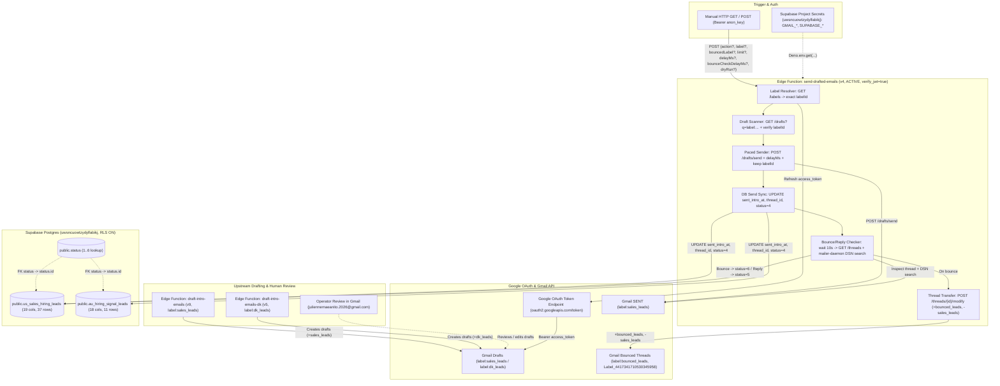
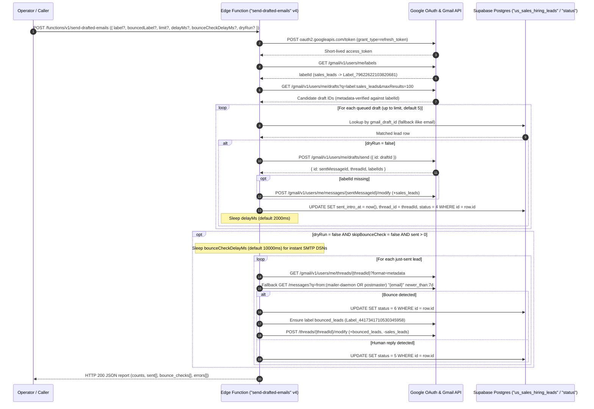
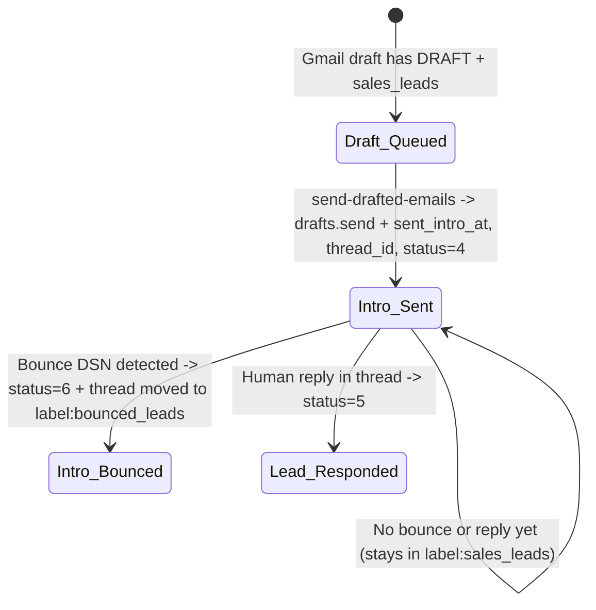

# Labeled Gmail Draft Dispatcher & Bounce Triage (`send-drafted-emails`) — System Architecture

> **Last updated:** 2026-11-23
> **Central Database / Core Platform:** Supabase (`uwsncuowtzydylfabikj`) — `public.us_sales_hiring_leads`, `public.au_hiring_signal_leads`, `public.status` + Gmail REST API (`juliennemaeanito.2026@gmail.com`)
> **Scope:** Serverless email-dispatch and post-send bounce-triage Edge Function that sends reviewed Gmail drafts under a target label (`label:sales_leads` by default), paces delivery (`delayMs`), stamps `sent_intro_at`, `thread_id`, and `status = 4` (`intro sent`) in Supabase, waits briefly for immediate SMTP delivery failures, inspects sent threads/DSNs for bounces or replies, updates `status = 6` (`intro bounced`) or `5` (`lead responded`), and transfers bounced Gmail threads from `label:sales_leads` into `label:bounced_leads` (`Label_4417341710530345958`).

---

## 1. Executive Summary

Both `draft-intro-emails` (US/AU hiring leads → `label:sales_leads`) and `draft-intro-emails-dk` (DK/EU leads → `label:dk_leads`) intentionally stop at Gmail **Drafts** so the operator can review copy before anything goes out. `send-drafted-emails` automates dispatch, database synchronization, and immediate bounce hygiene in one cohesive loop:

1. **Stage 1 — Label Resolution & Double-Verified Draft Discovery:** Refreshes the personal Gmail OAuth token (`GMAIL_*`), resolves the exact Gmail label ID for the requested label (default `sales_leads` → `Label_79622622103820681`), lists matching drafts via `GET /users/me/drafts?q=label:{label}`, fetches `metadata` (`To`, `Subject`, `labelIds`) for each candidate, and requires `labelId` in `draft.message.labelIds` (preventing cross-label leakage from `dk_leads`).
2. **Stage 2 — Paced Gmail Dispatch & Label Preservation:** Slices matched drafts to `limit` (default `5`, clamped `1..20`), sends each via `POST /gmail/v1/users/me/drafts/send`, ensures `labelId` stays attached on the sent message (`messages.modify`), and waits `delayMs` (default `2000` ms, clamped `0..15000` ms) between sends.
3. **Stage 3 — Immediate Supabase Send Sync (`sent_intro_at`, `thread_id`, `status = 4`):** Matches each sent draft back to `public.us_sales_hiring_leads` or `public.au_hiring_signal_leads` (primarily by exact `gmail_draft_id`, fallback `email ILIKE` where `sent_intro_at IS NULL`) and writes `sent_intro_at = now()`, `thread_id = sendResult.threadId`, and `status = 4` (`intro sent`).
4. **Stage 4 — Post-Send Bounce/Reply Detection & Thread Relabeling (`label:bounced_leads`):** Unless `skipBounceCheck: true`, waits `bounceCheckDelayMs` (default `10,000` ms, clamped `0..30000` ms) for instant SMTP hard-bounce DSNs (e.g., Microsoft 365 `550 5.4.1`), inspects each sent thread via `GET /users/me/threads/{threadId}` plus a fallback `from:(mailer-daemon OR postmaster) "{email}" newer_than:7d` search, and for any detected bounce:
   - Updates `status = 6` (`intro bounced`) in Supabase.
   - Ensures `label:bounced_leads` (`Label_4417341710530345958`) exists and transfers the entire bounced thread (`POST /users/me/threads/{threadId}/modify` with `addLabelIds: [bounced_leads]`, `removeLabelIds: [sales_leads]`) plus tags the DSN message itself.
   - If a non-automated human reply is detected in the thread, updates `status = 5` (`lead responded`).
5. **Standalone Re-Check Mode (`action: "check_bounces"`):** Allows re-running Stage 4 at any time on previously sent leads (e.g., for delayed bounces or replies) without sending any emails.

---

## 2. High-Level System Architecture

---

## 3. Execution Sequence / Lifecycle

---

## 4. Stage-by-Stage Component Breakdown

### Stage 1: Trigger, Auth & Label Resolution (`send-drafted-emails`)
- **System / Runtime:** Supabase Edge Function (Deno 2, `npm:@supabase/supabase-js@2`, native `fetch`)
- **Endpoint / Source Path:**
  - Live URL: `https://uwsncuowtzydylfabikj.supabase.co/functions/v1/send-drafted-emails` (**v4, `ACTIVE`, `verify_jwt: true`**, Function ID `5c286d33-391f-4931-b4d5-b2b461d0a4e0`)
  - Source: `supabase/functions/send-drafted-emails/index.ts`
- **Trigger / Live Schedule:** Manual HTTP `GET` (read-only queue preview, supports `?label=...`) or HTTP `POST` (`action: "send"` default, or `action: "check_bounces"`). No `pg_cron` schedule attached yet.

### Stage 2: Draft Discovery & Paced Dispatch (`action: "send"`)
- Resolves exact `labelId` (`sales_leads` → `Label_79622622103820681`), lists `q=label:{labelName}` up to 100 drafts, verifies `labelId` in each draft's `labelIds`, clamps to `limit` (`1..20`, default `5`), sends each via `POST /users/me/drafts/send`, keeps `labelId` attached, updates Supabase (`sent_intro_at`, `thread_id`, `status = 4`), and pauses `delayMs` (default `2000` ms) between sends.

### Stage 3: Bounce & Reply Triage + `label:bounced_leads` Transfer
- **Triggers automatically** at the end of every live send batch (after `bounceCheckDelayMs`, default `10,000` ms) AND on demand via `POST { "action": "check_bounces", "table"?: "us_sales_hiring_leads", "limit"?: 10, "leadIds"?: [...] }`.
- **Detection Rules (`isBounceMessage`):**
  - Sender contains `mailer-daemon`, `postmaster@`, or `mail delivery subsystem`.
  - Subject contains `delivery status notification (failure/delay)`, `undeliverable`, `mail delivery failed`, or `returned mail`.
  - Snippet contains `address not found`, `message blocked`, `recipient address rejected`, or SMTP `550 5.x.x`.
- **Actions on Bounce:**
  1. Updates `status = 6` (`intro bounced`) in Supabase (`us_sales_hiring_leads` / `au_hiring_signal_leads`).
  2. Resolves or creates `label:bounced_leads` (`Label_4417341710530345958`).
  3. Calls `POST /gmail/v1/users/me/threads/{threadId}/modify` with `{ addLabelIds: [bouncedLabelId], removeLabelIds: [sourceLabelId] }` (and also adds `bouncedLabelId` to any matched out-of-thread DSN message).
- **Actions on Human Reply:** Non-self, non-`SENT`, non-`Auto-Submitted` message in the thread updates `status = 5` (`lead responded`).

---

## 5. Central Data Contract (Database Schema & State Machine)

### Migrations Applied (`2026-11-23`)
- `supabase/migrations/20261123_add_thread_id_to_hiring_leads.sql`: Ensured `sent_intro_at` (`timestamptz`) and added `thread_id` (`text`) + partial `thread_id` indexes to `public.us_sales_hiring_leads` and `public.au_hiring_signal_leads`.
- `supabase/migrations/20261123_create_status_table_and_column.sql`: Created `public.status` (`id int PK`, `created_at timestamptz`, `description text UNIQUE`, RLS ON), seeded codes `1..6`, added `status integer NOT NULL DEFAULT 1 REFERENCES public.status(id)` + indexes to `public.us_sales_hiring_leads` (**19 columns**) and `public.au_hiring_signal_leads` (**18 columns**), and backfilled existing rows.

### Lookup Table: `public.status` (RLS ON)

| `id` | `description` | Meaning |
| ---: | --- | --- |
| `1` | `new lead` | Discovered lead, not yet enriched |
| `2` | `enriched` | Email enrichment completed (`enrichment_id` 1 or 2) |
| `3` | `intro drafted` | Gmail draft staged |
| `4` | `intro sent` | Intro sent via Gmail (`sent_intro_at` + `thread_id` set, no bounce detected) |
| `5` | `lead responded` | Non-automated human reply detected in thread |
| `6` | `intro bounced` | Hard bounce DSN detected; thread moved to `label:bounced_leads` |

### Lead Table Columns Read & Written by `send-drafted-emails`

| Table(s) | Column | Type | Read / Write | Purpose |
| --- | --- | --- | --- | --- |
| `us_sales_hiring_leads`, `au_hiring_signal_leads` | `id` | `uuid` | Read | Row update target |
| `us_sales_hiring_leads`, `au_hiring_signal_leads` | `gmail_draft_id` | `text` | Read | Primary lookup key matching Gmail draft ID (`r...`) |
| `us_sales_hiring_leads`, `au_hiring_signal_leads` | `email` | `text` | Read | Fallback lookup key & DSN bounce search target |
| `us_sales_hiring_leads`, `au_hiring_signal_leads` | `sent_intro_at` | `timestamptz` | Read + Write | Stamped `now()` immediately after `drafts.send` succeeds |
| `us_sales_hiring_leads`, `au_hiring_signal_leads` | `thread_id` | `text` | Read + Write | Gmail `threadId` saved on send and queried during bounce/reply checks |
| `us_sales_hiring_leads`, `au_hiring_signal_leads` | `status` | `integer` (FK → `public.status`) | Read + Write | Set to `4` on send, flipped to `6` on bounce or `5` on reply |
| `us_sales_hiring_leads`, `au_hiring_signal_leads` | `updated_at` | `timestamptz` | Trigger-written | Auto-refreshed by `BEFORE UPDATE` trigger |

### Draft Dispatch & Bounce Triage State Machine

### Live Snapshot Volume (Verified `2026-11-23`)

| `public.status` (`id` — `description`) | `us_sales_hiring_leads` Count | Notes |
| --- | ---: | --- |
| `1` — `new lead` | `0` | — |
| `2` — `enriched` | **27** | `27` rows with `enrichment_id = 2` (`email IS NULL`) |
| `3` — `intro drafted` | `0` | `0` queued drafts in `label:sales_leads` |
| `4` — `intro sent` | **9** | All `9` have `sent_intro_at` + `thread_id` in `label:sales_leads` |
| `5` — `lead responded` | `0` | — |
| `6` — `intro bounced` | **1** | Arcadius Health (`christopher.miller@arcadiushealth.com`, thread `1a2044d89d8daa88` moved to `label:bounced_leads`) |
| **Total** | **37** | (`au_hiring_signal_leads`: `11` total; `autodoc_customer_emails`: `2` drafts in `label:dk_leads`) |

---

## 6. External Data Mappings

### Request Contract (`POST /functions/v1/send-drafted-emails`)

| Request Field | Type / Default | Behavior |
| --- | --- | --- |
| `action` | `"send" \| "check_bounces"` / `"send"` | `"send"` dispatches labeled drafts + checks bounces; `"check_bounces"` only inspects sent rows |
| `label` | `string` / `"sales_leads"` | Source Gmail label to send from (and remove from bounced threads on transfer) |
| `bouncedLabel` / `bounced_label` | `string` / `"bounced_leads"` | Destination Gmail label for bounced threads (auto-created if absent) |
| `limit` | `number` / `5` | Max drafts sent or sent rows checked per call (clamped `1..20`) |
| `draftIds` / `draft_ids` | `string[]` / *(all in label)* | Optional whitelist of specific Gmail Draft IDs (`action="send"`) |
| `leadIds` / `lead_ids` | `string[]` / *(latest sent)* | Optional UUID filter for `action="check_bounces"` |
| `table` | `"us_sales_hiring_leads" \| "au_hiring_signal_leads"` | Target table for `action="check_bounces"` (default `us_sales_hiring_leads`) |
| `delayMs` / `delay_ms` | `number` / `2000` | Pacing delay between sends (`0..15000` ms) |
| `bounceCheckDelayMs` / `bounce_check_delay_ms` | `number` / `10000` | Wait time after sending before checking Gmail for DSNs (`0..30000` ms) |
| `skipBounceCheck` / `skip_bounce_check` | `boolean` / `false` | Skips post-send bounce verification if `true` |
| `dryRun` / `dry_run` | `boolean` / `false` | Read-only simulation (no Gmail send/modify, no Postgres updates) |

### Gmail API → Postgres & Label Mapping

| Gmail Endpoint / Signal | Action | Target Destination |
| --- | --- | --- |
| `POST /users/me/drafts/send` → `id`, `threadId` | Write `sent_intro_at`, `thread_id`, `status = 4` | `us_sales_hiring_leads` / `au_hiring_signal_leads` |
| `GET /users/me/threads/{threadId}` + `from:(mailer-daemon OR postmaster)` → bounce | Write `status = 6` + `POST /threads/{threadId}/modify` (`+bounced_leads`, `-sales_leads`) | Postgres `status` + Gmail `label:bounced_leads` (`Label_4417341710530345958`) |
| `GET /users/me/threads/{threadId}` → human reply | Write `status = 5` | Postgres `status` |

---

## 7. Systems, Identifiers & Configuration Inventory

### External Resources & Endpoints

| System | Identifier / Endpoint | Role |
| --- | --- | --- |
| Supabase Project | `uwsncuowtzydylfabikj` (`https://uwsncuowtzydylfabikj.supabase.co`) | Postgres DB + Edge Function host |
| Sending & Bounce Edge Function | `https://uwsncuowtzydylfabikj.supabase.co/functions/v1/send-drafted-emails` | Live **v4** (`ACTIVE`, `verify_jwt: true`, ID `5c286d33-391f-4931-b4d5-b2b461d0a4e0`) |
| Google OAuth Token API | `https://oauth2.googleapis.com/token` | Silent `refresh_token` → `access_token` exchange |
| Gmail Labels | `sales_leads` (`Label_79622622103820681`), `dk_leads` (`Label_4897757153022453021`), `bounced_leads` (`Label_4417341710530345958`) | Outreach queue separation & bounced-thread quarantine |
| Gmail REST Endpoints | `/users/me/{labels,drafts,drafts/send,threads/{id},threads/{id}/modify,messages,messages/{id}/modify}` | Draft dispatch, bounce/reply inspection, and thread relabeling |

### Active Schedules / Cron Table

| Job Name | Cron (UTC) | Local Time (UTC+8) | Target | Status |
| --- | --- | --- | --- | --- |
| *(None for `send-drafted-emails`)* | — | — | `send-drafted-emails` | Manual HTTP `POST` trigger only |
| *(35 unrelated `pg_cron` jobs on `uwsncuowtzydylfabikj`)* | Various | Various | Unrelated n8n workflows (`33` active, `2` inactive) | Untouched |

### Secrets & Environment Variables Matrix (Names Only)

| Component | Required Var / Secret Names | Storage Location |
| --- | --- | --- |
| `send-drafted-emails` (Supabase DB) | `SUPABASE_URL`, `SUPABASE_SERVICE_ROLE_KEY` | Auto-injected by Supabase Edge Runtime (`uwsncuowtzydylfabikj`) |
| `send-drafted-emails` (Gmail OAuth) | `GMAIL_CLIENT_ID`, `GMAIL_CLIENT_SECRET`, `GMAIL_REFRESH_TOKEN`, `GMAIL_USER_EMAIL` | Supabase Edge Function Secrets (`uwsncuowtzydylfabikj`), mirrored in GCP Secret Manager (`ai-and-business-automation`) & `~/.config/gmail_personal_oauth.json` |
| HTTP Caller Auth | `SUPABASE_ANON_KEY` | Fetched dynamically via Supabase Management API (`SUPABASE_ACCESS_TOKEN`) |

---

## 8. Key Operational Gotchas & Maintenance Notes

1. **Delayed Bounces Beyond `bounceCheckDelayMs` (10s):** Immediate hard bounces (like Microsoft 365 `550 5.4.1`) usually arrive within 1–5 seconds and are caught inline right after send. Soft/delayed bounces that arrive minutes or hours later can be caught anytime by invoking `POST { "action": "check_bounces", "limit": 20 }` (or scheduling a lightweight `pg_cron` job calling `action: "check_bounces"`).
2. **Upstream `status` Column Maintenance:** `send-drafted-emails` (v4) writes `status = 4` (`intro sent`), `5` (`lead responded`), and `6` (`intro bounced`). `us-sales-hiring-leads` inserts default `status = 1` (`new lead`). `enrich-hiring-leads` (v4) and `draft-intro-emails` (v9) do not yet update `status` to `2` (`enriched`) / `3` (`intro drafted`) on write — they still rely on `enrichment_id` and `drafted_at` unless updated in a future pass.
3. **DK Leads (`autodoc_customer_emails`) Sync Gap:** `SYNC_TABLES` currently covers `us_sales_hiring_leads` and `au_hiring_signal_leads` only, as `autodoc_customer_emails` does not have `sent_intro_at`, `thread_id`, or `status` columns yet.
4. **Gateway Timeout Budget:** Account for `limit * (delayMs / 1000 + 2) + bounceCheckDelayMs / 1000 + limit * 1.5 < 130s` (at defaults `limit: 5`, `delayMs: 2000`, `bounceCheckDelayMs: 10000`, total runtime is ~25–30s).
5. **Gmail OAuth Scope & 7-Day Token Expiry:** Requires `gmail.modify` (already active on `GMAIL_REFRESH_TOKEN`, verified live on `2026-11-22` with `drafts.send`, `threads.get`, `threads.modify`, and `labels.create`). Keep GCP project `ai-and-business-automation` (`654973590578`) OAuth Consent Screen **In Production**.
6. **Live Function Inventory (7 Active Functions on `uwsncuowtzydylfabikj`):** `hiring-signal-leads` (v9), `us-sales-hiring-leads` (v8), `enrich-hiring-leads` (v4), `draft-intro-emails` (v9), `enrich-autodoc-employees` (v3), `draft-intro-emails-dk` (v5), and `send-drafted-emails` (v4).
