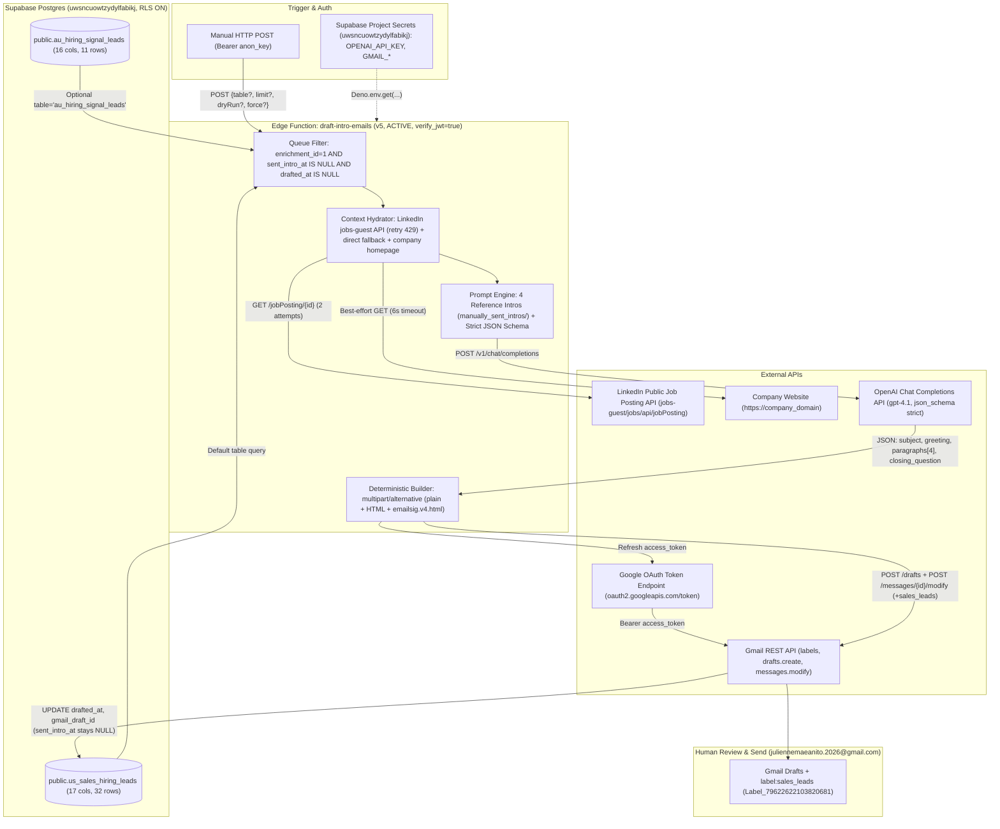
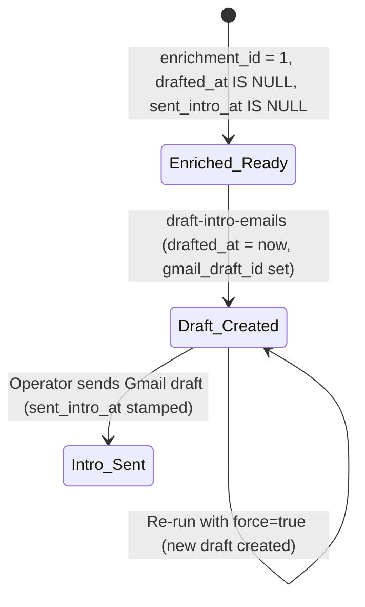

# Tailored Email Intro Drafting (`draft-intro-emails`) — System Architecture

> **Last updated:** 2026-11-21
> **Central Database / Core Platform:** Supabase (`uwsncuowtzydylfabikj`) — `public.us_sales_hiring_leads` & `public.au_hiring_signal_leads` + OpenAI (`gpt-4.1`) + Gmail API (`juliennemaeanito.2026@gmail.com`)
> **Scope:** Serverless cold-outreach drafting pipeline that pulls enriched, undrafted hiring leads from Supabase, fetches live LinkedIn job post descriptions and company context, generates reference-matched intro emails via OpenAI structured JSON output, wraps them in clean HTML with the `emailsig.v4.html` signature, saves labeled Gmail drafts under `label:sales_leads`, and stamps `drafted_at` + `gmail_draft_id` for human-in-the-loop review and zero-duplicate idempotency.

---

## 1. Executive Summary

Once Stage 2 enrichment resolves a verified decision-maker email (`enrichment_id = 1`), manually researching each LinkedIn job listing, matching the tone of previously sent intros, formatting the custom HTML signature, and saving labeled Gmail drafts becomes the primary outreach bottleneck. `draft-intro-emails` automates drafting end-to-end while keeping a **human-in-the-loop review gate** (saving Gmail **drafts** rather than auto-sending, leaving `sent_intro_at = NULL` until manually sent):

1. **Stage 1 — Enriched Queue Selection (`public.us_sales_hiring_leads` / `public.au_hiring_signal_leads`):** Queries rows with `enrichment_id = 1`, `email IS NOT NULL`, `sent_intro_at IS NULL`, and `drafted_at IS NULL` (unless `force: true`), bounded by `limit` (default `10`, max `25`).
2. **Stage 2 — Live Context Hydration (LinkedIn Job Post + Company Homepage):** Extracts the numeric LinkedIn Job ID from `job_url`, fetches the public guest job endpoint (`linkedin.com/jobs-guest/jobs/api/jobPosting/{jobId}`) with HTTP `429`/`5xx` retry + direct `job_url` fallback, and pulls a lightweight best-effort summary from `https://{company_domain}`.
3. **Stage 3 — Reference-Mirrored Copy Generation (OpenAI `gpt-4.1` Strict JSON Schema):** Sends the lead record, scraped LinkedIn posting, company summary, and all 4 manually sent reference intros (`manually_sent_intros/`) as few-shot examples to OpenAI Chat Completions with `strict: true` JSON Schema output (`subject`, `greeting`, `paragraphs[4]`, `closing_question`).
4. **Stage 4 — Deterministic MIME Assembly & Gmail Labeled Draft Creation:** Escapes plain-text paragraphs, assembles clean `<div dir="ltr">` HTML with the inline-table `emailsig.v4.html` signature alongside a matching `text/plain` part in RFC 2822 `multipart/alternative` format, refreshes the personal Gmail OAuth token (`GMAIL_*`), creates the draft via `drafts.create`, and attaches `label:sales_leads` (`Label_79622622103820681`) via `messages.modify`.
5. **Stage 5 — Idempotency Tracking & Human Review Handoff:** Stamps `drafted_at = now()` and `gmail_draft_id` on the Supabase lead row (keeping `sent_intro_at = NULL`). Subsequent runs automatically skip already-drafted leads while the operator reviews and clicks Send in Gmail under **Drafts** / `label:sales_leads`.

---

## 2. High-Level System Architecture



---

## 3. Execution Sequence / Lifecycle

```mermaid
sequenceDiagram
    autonumber
    participant Op as Operator / Caller
    participant EF as Edge Function (draft-intro-emails)
    participant DB as Supabase Postgres (us_sales_hiring_leads)
    participant LI as LinkedIn Public Job API & Company Site
    participant OAI as OpenAI API (gpt-4.1)
    participant Google as Google OAuth & Gmail API

    Op->>EF: POST /functions/v1/draft-intro-emails ({ table?, limit?, dryRun?, force? })
    EF->>DB: SELECT * WHERE enrichment_id = 1 AND sent_intro_at IS NULL AND drafted_at IS NULL LIMIT N
    DB-->>EF: Queued lead rows

    alt dryRun = false AND queued > 0
        EF->>Google: POST oauth2.googleapis.com/token (grant_type=refresh_token)
        Google-->>EF: Short-lived access_token
        EF->>Google: GET /gmail/v1/users/me/labels (resolve or create sales_leads)
        Google-->>EF: labelId (Label_79622622103820681)
    end

    loop For each queued lead
        EF->>LI: GET jobs-guest/jobs/api/jobPosting/{jobId} (retry 429/5xx; fallback direct job_url)
        LI-->>EF: Job title, criteria, full description
        EF->>LI: Best-effort GET https://{company_domain} (6s timeout)
        LI-->>EF: Homepage title, meta description, excerpt
        EF->>OAI: POST /v1/chat/completions (gpt-4.1, 4 few-shot references, strict JSON schema)
        OAI-->>EF: { subject, greeting, paragraphs[4], closing_question }
        Note over EF: Escape text -> build multipart/alternative MIME (plain + HTML + emailsig.v4.html)

        alt dryRun = false
            EF->>Google: POST /gmail/v1/users/me/drafts ({ message: { raw: base64url } })
            Google-->>EF: { id: draftId, message: { id: messageId } }
            EF->>Google: POST /gmail/v1/users/me/messages/{messageId}/modify ({ addLabelIds: [labelId] })
            Google-->>EF: labelIds: ["DRAFT", "Label_79622622103820681"]
            EF->>DB: UPDATE SET drafted_at = now(), gmail_draft_id = draftId WHERE id = lead.id
            Note over DB: BEFORE UPDATE trigger auto-refreshes updated_at
        end
    end

    EF-->>Op: HTTP 200 JSON report (counts, drafts[], errors[])
```

---

## 4. Stage-by-Stage Component Breakdown

### Stage 1: Trigger, Validation & Queue Selection (`draft-intro-emails`)
- **System / Runtime:** Supabase Edge Function (Deno 2, `npm:@supabase/supabase-js@2`, native `fetch` — zero third-party AI SDK bundle overhead)
- **Endpoint / Source Path:**
  - Live URL: `https://uwsncuowtzydylfabikj.supabase.co/functions/v1/draft-intro-emails` (**v5, `ACTIVE`, `verify_jwt: true`**)
  - Source: `supabase/functions/draft-intro-emails/index.ts`
  - Specification Prompt: `prompts/261121_email_intro_edge_function.txt`
- **Trigger / Live Schedule:** Manual HTTP `POST` (`GET` returns health status, active defaults, and boolean `env_ready` flags). No `pg_cron` schedule attached.
- **Queue / Input Filter:**
  - Strict table allowlist: `us_sales_hiring_leads` (default) or `au_hiring_signal_leads`.
  - Default SQL filter: `enrichment_id = 1 AND sent_intro_at IS NULL AND email IS NOT NULL AND drafted_at IS NULL` ordered by `created_at DESC`, capped at `limit` (default `10`, clamped `1..25`).
  - Optional overrides: `leadIds` (`uuid[]`), `force: true` (includes already-drafted rows), `dryRun: true` (returns generated copy previews without creating Gmail drafts or updating DB), `label` (default `"sales_leads"`), `model` (default `"gpt-4.1"`).

### Stage 2: LinkedIn Job Post & Company Context Hydration
- **System / Runtime:** Inside `draft-intro-emails` (`fetchJobPostContext`)
- **Processing Logic:**
  1. Extracts numeric LinkedIn Job ID from `lead.job_url` via regex (`jobs/view/...-{id}` or `currentJobId={id}`).
  2. Calls `https://www.linkedin.com/jobs-guest/jobs/api/jobPosting/{jobId}` using realistic browser headers with `fetchWithRetry` (up to 2 attempts with 1.5s backoff on HTTP `429` or `5xx`, 12s timeout).
  3. Parses HTML deterministically for `top-card-layout__title`, `description__job-criteria-item` (Seniority, Employment Type, Function, Industry), and `show-more-less-html__markup` (capped at 6,000 chars).
  4. If the guest API returns an empty/short body or fails, falls back to fetching `lead.job_url` directly with the same retry helper.
  5. Performs a best-effort `GET https://{company_domain}` (6s timeout) to capture `<title>`, `<meta name="description">`, and a 1,200-char body excerpt.
- **Outputs:** Structured `JobPostContext` (`source`: `linkedin_guest_api` | `linkedin_direct` | `unavailable`) passed into the LLM prompt.

### Stage 3: Tailored Email Copy Generation (OpenAI `gpt-4.1`)
- **System / Runtime:** OpenAI Chat Completions REST API (`https://api.openai.com/v1/chat/completions`)
- **Reference Corpus Embedded in System Prompt:** All 4 manually sent emails from `manually_sent_intros/` (`ResQ`, `WOW Recruitment`, `SuitePad`, `Homeland Talent Solutions`) paired with their live sent subjects from Gmail.
- **Processing Logic:**
  1. Enforces strict JSON Schema output (`response_format.type = "json_schema"`, `strict: true`, `additionalProperties: false`) returning `{ subject, greeting, paragraphs, closing_question }`.
  2. Grounds Paragraph 1 strictly in verified LinkedIn posting/company facts (never fabricating tools or duties).
  3. Preserves Julienne's real proof point (`30+ workflow system` for a travel & adventure company saving `~40 hours a week`), spaced em-dashes (` — `), en-dashes (`2–3`), and soft 15-minute no-pitch CTA.
  4. Conditionally applies the referral parenthetical (`"(And if someone on your sales or RevOps side owns this...)"`) only for non-Executive / non-Sales roles (omitting it for CEOs, Owners, Founders, VPs/Directors of Sales/BD/Acquisitions, and RevOps leads).

### Stage 4: Deterministic MIME Builder & Labeled Gmail Draft Creation
- **System / Runtime:** Gmail REST API (`https://gmail.googleapis.com/gmail/v1/users/me/*`) via Personal Gmail OAuth 2.0 (`juliennemaeanito.2026@gmail.com`)
- **Signature Template Source:** Clean inline-table HTML matching `email_signature/emailsig.v4.html` (zero external images, zero Gmail `data-saferedirecturl` clutter, evergreen Calendly link, warm ivory/espresso/burnished-gold palette).
- **Processing Logic:**
  1. Escapes all LLM plain-text paragraphs with `escapeHtml()` and wraps them in `<div dir="ltr">...<br><br>Best,<br><div dir="ltr" class="gmail_signature" data-smartmail="gmail_signature">...</div></div>`.
  2. Encodes a standards-compliant RFC 2822 `multipart/alternative` message (`text/plain; charset="UTF-8"` + `text/html; charset="UTF-8"`, Base64 body parts, RFC 2047 UTF-8 header encoding, Base64url outer envelope).
  3. Exchanges `GMAIL_REFRESH_TOKEN` for a short-lived `access_token` at `oauth2.googleapis.com/token`.
  4. Resolves the target label ID via `GET /users/me/labels` (creating the label automatically if absent; resolves `sales_leads` -> `Label_79622622103820681`).
  5. Creates the draft via `POST /users/me/drafts` and immediately attaches `sales_leads` to `draft.message.id` via `POST /users/me/messages/{messageId}/modify` with `{ addLabelIds: [labelId] }`.
- **Outputs & Handoff Signal:** Updates the Supabase lead row with `drafted_at = now()` and `gmail_draft_id = draft.id`. `sent_intro_at` stays `NULL` until the operator reviews and sends the draft in Gmail (at which point Gmail retains `label:sales_leads` on the sent thread).

---

## 5. Central Data Contract (Database Schema & State Machine)

### Migration Applied (`2026-11-21`)
- `supabase/migrations/20261121_add_draft_columns_to_hiring_leads.sql` added `drafted_at` (`timestamptz`), `gmail_draft_id` (`text`), and partial queue indexes (`idx_us_sales_hiring_leads_draft_queue`, `idx_au_hiring_signal_leads_draft_queue`) to both `public.us_sales_hiring_leads` (**17 columns**) and `public.au_hiring_signal_leads` (**16 columns**).

### Key Columns Read & Written by `draft-intro-emails`

| Column | Type | Nullable / Default | Written By | Read By | Purpose |
| --- | --- | --- | --- | --- | --- |
| `id` | `uuid` | `NO` / `gen_random_uuid()` | Postgres | `draft-intro-emails` | Update key & optional `leadIds` filter |
| `company` | `text` | `NO` / — | Discovery Edge Functions | `draft-intro-emails` | Email copy personalization |
| `poc_name` | `text` | `NO` / — | Discovery Edge Functions | `draft-intro-emails` | First-name greeting & `To:` display name |
| `poc_role` | `text` | `NO` / — | Discovery Edge Functions | `draft-intro-emails` | Tone & referral-line conditioning |
| `company_domain` | `text` | `YES` / `NULL` | Discovery Edge Functions | `draft-intro-emails` | Best-effort company homepage context fetch |
| `hiring_role` | `text` | `YES` / `NULL` | Discovery Edge Functions | `draft-intro-emails` | LinkedIn hiring signal hook |
| `job_location` *(US table only)* | `text` | `YES` / `NULL` | `us-sales-hiring-leads` | `draft-intro-emails` | Geographic context in copy |
| `job_url` | `text` | `YES` / `NULL` | Discovery Edge Functions | `draft-intro-emails` | LinkedIn Job ID extraction & fallback fetch |
| `email` | `text` | `YES` / `NULL` | `enrich-hiring-leads` | `draft-intro-emails` | Gmail `To:` recipient address |
| `enrichment_id` | `integer` | `YES` / `NULL` | `enrich-hiring-leads` | `draft-intro-emails` | Queue filter (`= 1`) |
| `drafted_at` | `timestamptz` | `YES` / `NULL` | `draft-intro-emails` | `draft-intro-emails` | Idempotency guard (`IS NULL` unless `force: true`) |
| `gmail_draft_id` | `text` | `YES` / `NULL` | `draft-intro-emails` | Operator / future sender | Gmail Draft ID (`r...`) for audit/linking |
| `sent_intro_at` | `timestamptz` | `YES` / `NULL` | Manual / future Gmail sync | `draft-intro-emails` | Queue exclusion (`IS NULL`) |
| `updated_at` | `timestamptz` | `NO` / `now()` | `BEFORE UPDATE` trigger | Audit | Auto-refreshed when `drafted_at` is stamped |

### Lead Drafting & Outreach State Machine



### Live Snapshot Volume (Queried `2026-11-21`)

| Table | Total | `enrichment_id = 1` | `enrichment_id = 2` | Unenriched | Drafted (`drafted_at` Set) | Sent (`sent_intro_at` Set) | Ready to Draft | Drafted Awaiting Send |
| --- | ---: | ---: | ---: | ---: | ---: | ---: | ---: | ---: |
| `public.us_sales_hiring_leads` | **32** | 6 | 26 | 0 | **3** | 3 | **0** | **3** |
| `public.au_hiring_signal_leads` | **11** | 1 | 0 | 10 | **0** | 1 | **0** | **0** |

---

## 6. External Data Mappings

### Request / Response Contract (`POST /functions/v1/draft-intro-emails`)

| Request Field | Type / Default | Behavior |
| --- | --- | --- |
| `table` | `string` / `"us_sales_hiring_leads"` | Allowlisted to `us_sales_hiring_leads` or `au_hiring_signal_leads` |
| `limit` | `number` / `10` | Clamped `1..25` rows per invocation to stay well inside Edge Function gateway timeout |
| `leadIds` | `string[]` / `[]` | Optional UUID filter to target specific leads |
| `label` | `string` / `"sales_leads"` | Gmail label attached to every created draft |
| `model` | `string` / `"gpt-4.1"` | OpenAI Chat Completions model ID |
| `dryRun` | `boolean` / `false` | Runs scraping + OpenAI generation and returns `plain_preview` without calling Gmail or updating Postgres |
| `force` | `boolean` / `false` | Includes rows where `drafted_at IS NOT NULL` |

### OpenAI Structured Output -> Gmail MIME Mapping

| OpenAI JSON Field | Transformation | Target Destination |
| --- | --- | --- |
| `subject` | RFC 2047 UTF-8 MIME header encoding | Gmail `Subject:` header |
| `greeting` | HTML-escaped + `<br><br>` | First line of HTML & plain body |
| `paragraphs[0..3]` | HTML-escaped, joined by `<br><br>` | 4 tailored body paragraphs |
| `closing_question` | HTML-escaped + `<br><br>Best,<br>` + `emailsig.v4.html` | Closing line before signature |

---

## 7. Systems, Identifiers & Configuration Inventory

### External Resources & Endpoints

| System | Identifier / Endpoint | Role |
| --- | --- | --- |
| Supabase Project | `uwsncuowtzydylfabikj` (`https://uwsncuowtzydylfabikj.supabase.co`) | Postgres DB + Edge Function host |
| Drafting Edge Function | `https://uwsncuowtzydylfabikj.supabase.co/functions/v1/draft-intro-emails` | Live v5 (`ACTIVE`, `verify_jwt: true`) |
| LinkedIn Public Job API | `https://www.linkedin.com/jobs-guest/jobs/api/jobPosting/{jobId}` | Unauthenticated HTML job posting retrieval |
| OpenAI API | `https://api.openai.com/v1/chat/completions` | Structured JSON email drafting (`gpt-4.1`) |
| Google OAuth Token API | `https://oauth2.googleapis.com/token` | Silent `refresh_token` -> `access_token` exchange |
| Gmail REST API | `https://gmail.googleapis.com/gmail/v1/users/me/{labels,drafts,messages}` | Draft creation & `sales_leads` (`Label_79622622103820681`) attachment |

### Active Schedules / Cron Table

| Job Name | Cron (UTC) | Local Time (UTC+8) | Target | Status |
| --- | --- | --- | --- | --- |
| *(None for `draft-intro-emails`)* | — | — | `draft-intro-emails` | Manual HTTP `POST` trigger only |
| *(35 unrelated `pg_cron` jobs on `uwsncuowtzydylfabikj`)* | Various | Various | Unrelated n8n workflows (33 active, 2 inactive) | Untouched (outside Client Finder scope) |

### Secrets & Environment Variables Matrix (Names Only)

| Component | Required Var / Secret Names | Storage Location |
| --- | --- | --- |
| `draft-intro-emails` (Supabase DB) | `SUPABASE_URL`, `SUPABASE_SERVICE_ROLE_KEY` | Auto-injected by Supabase Edge Runtime (`uwsncuowtzydylfabikj`) |
| `draft-intro-emails` (OpenAI LLM) | `OPENAI_API_KEY` | Supabase Edge Function Secrets (`uwsncuowtzydylfabikj`), synced from local `~/Downloads/OPENAI_API_KEY.txt` |
| `draft-intro-emails` (Gmail OAuth) | `GMAIL_CLIENT_ID`, `GMAIL_CLIENT_SECRET`, `GMAIL_REFRESH_TOKEN`, `GMAIL_USER_EMAIL` | Supabase Edge Function Secrets (`uwsncuowtzydylfabikj`), mirrored in personal GSM (`ai-and-business-automation`) & `~/.config/gmail_personal_oauth.json` |
| Unused / Depleted Secret *(note)* | `GEMINI_API_KEY` | Present in Supabase Secrets (`uwsncuowtzydylfabikj`, synced from personal GSM `gemini_api_key_ai_and_business_automation`), not currently used by `draft-intro-emails` due to HTTP 402 depleted AI Studio credits |
| HTTP Caller Auth | `SUPABASE_ANON_KEY` | Fetched dynamically via Supabase Management API (`SUPABASE_ACCESS_TOKEN`) |

---

## 8. Key Operational Gotchas & Maintenance Notes

1. **LLM Provider Switch (`GEMINI_API_KEY` HTTP 402 -> `OPENAI_API_KEY`):** Initial v1 used Gemini (`gemini-3.8-flash`) with `gemini_api_key_ai_and_business_automation` from personal GSM, which returned HTTP `402 RESOURCE_EXHAUSTED` (depleted AI Studio prepayment credits). `draft-intro-emails` was switched to OpenAI `gpt-4.1` (v4/v5) using `OPENAI_API_KEY`. `GEMINI_API_KEY` remains in Supabase Secrets and can be removed or reused once AI Studio billing is topped up.
2. **Intermittent LinkedIn HTTP `429` Rate Limiting:** LinkedIn occasionally returns HTTP `429` on datacenter IPs for `jobs-guest/jobs/api/jobPosting/{jobId}`. `fetchWithRetry` (2 attempts with 1.5s backoff) + direct `job_url` fallback + company homepage fetch resolved this on live runs (`3/3` succeeded via `linkedin_guest_api` in v5). Keep batch `limit <= 10` per call to avoid triggering sustained rate limits or approaching Supabase's 150s gateway timeout.
3. **Draft Labeling Requires Two Gmail API Calls:** `POST /gmail/v1/users/me/drafts` does not reliably attach custom user labels in a single call. `draft-intro-emails` explicitly calls `POST /gmail/v1/users/me/messages/{draft.message.id}/modify` with `addLabelIds: [salesLeadsLabelId]` right after creation so drafts appear immediately under both **Drafts** and `label:sales_leads` (and retain `sales_leads` after you click Send).
4. **Manual `sent_intro_at` Sync Gap:** Because drafts are intentionally sent manually by the human operator after review, `sent_intro_at` is **not** automatically updated when you click Send in Gmail. A future lightweight Gmail sync function (matching `SENT` messages under `label:sales_leads` by `To:` email or `gmail_message_id`) can backfill `sent_intro_at` automatically.
5. **Gmail OAuth Refresh Token 7-Day Expiry Risk:** As noted in `system_architecture_gmail_oauth.md`, ensure the OAuth Consent Screen in GCP project `ai-and-business-automation` (`654973590578`) is published **In Production** so `GMAIL_REFRESH_TOKEN` does not expire every 7 days.
6. **Live Edge Function Version Drift vs. Older Docs:** Live Supabase (`uwsncuowtzydylfabikj`) now hosts 4 active Client Finder Edge Functions: `hiring-signal-leads` (v9), `us-sales-hiring-leads` (v6), `enrich-hiring-leads` (v4), and `draft-intro-emails` (v5). Older doc `system_architecture_client_finder.md` (dated `2026-11-19`) still references pre-rename `hiring_signal_leads` and earlier versions.
